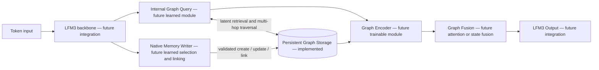

# RUTAM architecture — phase 01

Developed by **Anvaya.sh**. This phase implements an independent persistent graph
subsystem intended to become internal model memory. It does not implement a
language model or conventional prompt-injection RAG pipeline.

## Implemented now

`RUTAMConfig` provides immutable typed settings and strict YAML/override
validation. `Node` and `Edge` hold immutable validated records. `Graph` owns
stable identifiers, canonical ordering, versioned deterministic CRUD, typed
directed/undirected edges and bounded breadth-first traversal. `GraphState` is a
detached CPU tensor interface plus textual metadata; it is a data boundary for
future learned modules, not an encoder.

`GraphStorage` serializes the five specified tensors using safetensors, stores
text and ID mappings in a JSON sidecar, and publishes a manifest as the snapshot
commit record. Backbone weights are never opened. Storage format schema versions
are separate from graph mutation versions: saving does not increment the graph
version. Every checkpoint receives a new UUID, including unchanged graphs.

Missing embeddings use zero tensor rows and explicit metadata flags. Persisted
IDs are int64 and survive deletion of other nodes; edge indices refer to tensor
rows. Retired node IDs and relationship label IDs persist across restarts.
Float32 canonicalization happens at the graph API boundary. Graph records require
timezone-aware creation/update times; operations use UTC by default. Confidence
and provenance are recorded without claiming automated truth verification.

## Intended future model pathway — not implemented

Future integration should let backbone hidden states produce graph queries,
select/traverse memories, encode graph structure, and fuse representations back
into model computation. This is a proposed architectural pathway; the current
`neighbors`/`traverse` APIs are deterministic structural operations, not learned
retrieval. Stored graph text is not fetched and inserted into a language-model
prompt. Persistent graph updates remain independent of backbone weight updates.

The supplied `LiquidAI/LFM3-1.7B-Base` identifier is retained as requested without
verifying model availability or internal APIs. Before adding any adapter, inspect
the actual released model configuration, supported loading interface, tensor
shapes, attention/state layout, licensing and extension points. No LFM3 class
names, layer hooks or compatibility shims are fabricated in this foundation.

## Future work boundaries

- **Graph query and encoder:** learn selection and structural representations;
  define differentiable boundaries and missing-embedding initialization.
- **Fusion and graph-aware attention:** choose verified backbone integration
  points, compatible dimensions, masks, devices and dtype conversions.
- **Native memory writing:** learn remembering, updating, confidence calibration,
  relationship linking and provenance policy. Core structural validation remains
  mandatory. `memory.validation_enabled` is reserved for semantic validation;
  it currently does not disable any core invariant.
- **Training and evaluation:** memory instruction tuning, teacher distillation,
  reasoning improvements, Rust expertise, authorized cybersecurity skills, and
  safety alignment require separate designs, datasets and evaluations.
- **Recurrent reasoning:** loops inspired conceptually by NVIDIA Dory are future
  research; no algorithm or compatibility claim is implemented here.

## Snapshot consistency and limits

The manifest lists exact SHA-256 hashes and byte lengths for `graph.safetensors`
and `graph.json`, with a shared UUID and schema/graph versions. Load validates
all three, then tensor contracts, metadata mappings, records, provenance,
relationship labels, capacities and references. Unknown schema versions fail
closed; schema migration is future work.

Local POSIX advisory locks coordinate readers/writers, temporary files are
flushed before publication, payload renames are synced before the manifest
rename, and the directory is synced after commit. These are atomic individual
replacements, not an atomic multi-file transaction. A crash halfway through
replacement can make the current checkpoint unavailable, but cannot make a
partial snapshot valid. Retaining historical generations or a write-ahead log
could provide automatic recovery in a later phase. The current implementation
can recover by saving again or restoring a complete external backup.

The in-memory graph is single-threaded; file locking does not merge concurrent
graph edits. Concurrent saves publish one complete snapshot in lock order. The
last writer wins; there is no optimistic concurrency control. Auto-save restores
in-memory state after a storage error, but an interrupted publication or failed
final durability sync can still leave disk in a different state and requires
explicit load/retry handling. No distributed consistency, hostile-file
authentication, graph history, schema migration or benchmark claim is provided.

Default embeddings alone occupy about 51.2 MB at 100,000 nodes × 128 float32
values. JSON, Python records, edges and temporary save/load buffers add overhead.
Snapshots are materialized in memory and the graph is validated on each save;
this favors correctness and testability on a CPU development machine, not
large-scale throughput. No model is loaded into the 12 GB development budget.
