# RUTAM architecture

Developed by **Anvaya.sh**. This phase implements an independent persistent graph
subsystem, trainable graph encoder, neural graph selector and native neural
query head, bounded neural path reasoning and a proposal-only graph linker.
LFM3 integration remains future work.

## Implemented now

`RUTAMConfig` provides immutable typed settings and strict YAML/override
validation. `Node` and `Edge` hold immutable validated records. `Graph` owns
stable identifiers, canonical ordering, versioned deterministic CRUD, typed
directed/undirected edges and bounded breadth-first traversal. `GraphState` is a
detached CPU tensor interface plus textual metadata; it is a data boundary for
future learned modules, not an encoder.

`RUTAMGraphEncoder` now consumes this data boundary to produce contextualized
neural node states. `NodeProjection`, `RelationEmbedding` and
`RelationAwareMessagePassing` are actual trainable PyTorch modules; no pretrained
model or external API is involved.

`RUTAMGraphSelector` now scores graph states using continuous neural queries,
with deterministic hard top-k or a differentiable soft memory context. Scoring
is trainable, but all neural modules are untrained unless callers supply weights.

`RUTAMNeuralQueryHead` now pools externally supplied hidden-state tensors into
continuous queries, optionally conditions them on the current graph summary,
and predicts a graph-use gate. This implements a neural interface, not an LFM3
adapter: dimensions are explicitly configured and no backbone is loaded.

`RUTAMGraphTraversal` enumerates bounded tensor paths, encodes ordered node,
relation, direction and hop features with a GRU, and constructs a query-conditioned
reasoning context. `RUTAMGraphLinker` independently scores bounded node pairs
and returns unverified, versioned relationship proposals without committing them.

`GraphStorage` serializes the five specified tensors using safetensors, stores
text and ID mappings in a JSON sidecar, and publishes a manifest as the snapshot
commit record. Backbone weights are never opened. Storage format schema versions
are separate from graph mutation versions: saving does not increment the graph
version. Every checkpoint receives a new UUID, including unchanged graphs.

Missing embeddings use zero tensor rows and explicit metadata flags. Persisted
IDs are int64 and survive deletion of other nodes; edge indices refer to tensor
rows. Retired node IDs and relationship label IDs persist across restarts.
Float32 canonicalization happens at the graph API boundary. Graph records require
timezone-aware creation/update times; operations use UTC by default. Confidence
and provenance are recorded without claiming automated truth verification.

## Intended backbone integration — future

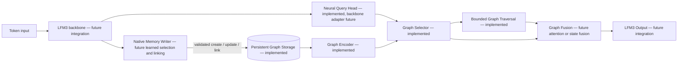

Future integration should let backbone hidden states produce graph queries,
select/traverse memories, encode graph structure, and fuse representations back
into model computation. This is a proposed architectural pathway; the current
`neighbors`/`traverse` APIs are deterministic structural operations, not learned
retrieval. Stored graph text is not fetched and inserted into a language-model
prompt. Persistent graph updates remain independent of backbone weight updates.

The supplied `LiquidAI/LFM3-1.7B-Base` identifier is retained as requested without
verifying model availability or internal APIs. Before adding any adapter, inspect
the actual released model configuration, supported loading interface, tensor
shapes, attention/state layout, licensing and extension points. No LFM3 class
names, layer hooks or compatibility shims are fabricated in this foundation.

## Future work boundaries

- **Backbone hidden-state adapter:** connect verified model outputs to the
  implemented query head. Actual LFM3 APIs and dimensions still need verification.
- **Validation and commit control:** evaluate unverified relationship proposals
  before any confirmed persistent graph update. Traversal/linking add no commit path.
- **Fusion and graph-aware attention:** choose verified backbone integration
  points, compatible dimensions, masks, devices and dtype conversions.
- **Native memory writing:** learn remembering, updating, confidence calibration,
  relationship linking and provenance policy. Core structural validation remains
  mandatory. `memory.validation_enabled` is reserved for semantic validation;
  it currently does not disable any core invariant.
- **Training and evaluation:** memory instruction tuning, teacher distillation,
  reasoning improvements, Rust expertise, authorized cybersecurity skills, and
  safety alignment require separate designs, datasets and evaluations.
- **Recurrent reasoning:** loops inspired conceptually by NVIDIA Dory are future
  research; no algorithm or compatibility claim is implemented here.

## Snapshot consistency and limits

The manifest lists exact SHA-256 hashes and byte lengths for `graph.safetensors`
and `graph.json`, with a shared UUID and schema/graph versions. Load validates
all three, then tensor contracts, metadata mappings, records, provenance,
relationship labels, capacities and references. Unknown schema versions fail
closed; schema migration is future work.

Local POSIX advisory locks coordinate readers/writers, temporary files are
flushed before publication, payload renames are synced before the manifest
rename, and the directory is synced after commit. These are atomic individual
replacements, not an atomic multi-file transaction. A crash halfway through
replacement can make the current checkpoint unavailable, but cannot make a
partial snapshot valid. Retaining historical generations or a write-ahead log
could provide automatic recovery in a later phase. The current implementation
can recover by saving again or restoring a complete external backup.

The in-memory graph is single-threaded; file locking does not merge concurrent
graph edits. Concurrent saves publish one complete snapshot in lock order. The
last writer wins; there is no optimistic concurrency control. Auto-save restores
in-memory state after a storage error, but an interrupted publication or failed
final durability sync can still leave disk in a different state and requires
explicit load/retry handling. No distributed consistency, hostile-file
authentication, graph history, schema migration or benchmark claim is provided.

Default embeddings alone occupy about 51.2 MB at 100,000 nodes × 128 float32
values. JSON, Python records, edges and temporary save/load buffers add overhead.
Snapshots are materialized in memory and the graph is validated on each save;
this favors correctness and testability on a CPU development machine, not
large-scale throughput. No backbone model is loaded into the development budget.

## Native graph encoder — implemented in phase 02

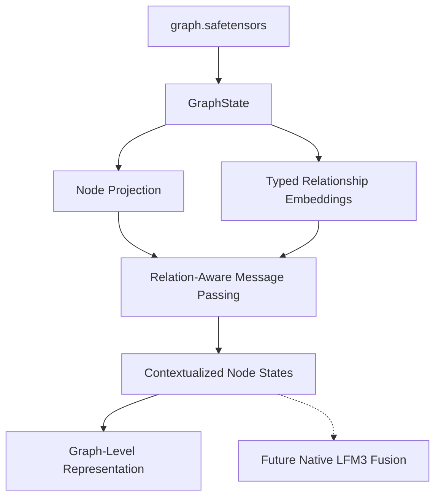

The diagram's disk-to-state step uses `GraphStorage.load().to_state()` before
`forward`; it still requires the JSON sidecar and manifest. The neural module
receives a `GraphState` and performs no disk operations or graph writes.

### Configuration and tensor contracts

The optional `encoder` section of `RUTAMConfig` defaults to:

```yaml
encoder:
  input_dim: 128
  hidden_dim: 128
  num_layers: 2
  num_relation_types: 32
  dropout: 0.1
  activation: gelu
  aggregation: mean
  residual: true
  layer_norm: true
```

Construct with `RUTAMGraphEncoder(config.encoder)`. Dimensions/vocabulary/layer
count must be positive integers, dropout must be finite in `[0,1)`, activation
is `gelu`, `relu` or `silu`, and aggregation is `mean` or `sum`. Residual and
normalization flags must be booleans. Encoder dimensions remain independent of
the unverified LFM3 hidden size. To encode graphs with another embedding width,
set `encoder.input_dim` to match `graph.embedding_dim`. This equality is checked
at encoding time, preserving older graph-only configurations.

| Input from GraphState | CPU dtype | Shape / meaning |
|---|---|---|
| `node_embeddings` | float32 | `[N,D]`, D must equal encoder input_dim |
| `node_ids` | int64 | `[N]`, persistent IDs in canonical sorted row order |
| `edge_index` | int64 | `[2,E]`, source and destination **row offsets** |
| `edge_types` | int64 | `[E]`, IDs in `[0,R)` |
| `edge_weights` | float32 | `[E]`, finite and nonnegative |

`R = num_relation_types` and `H = hidden_dim`. State shape/dtype/reference
validation runs before neural operations. Every declared relationship type ID,
including unused persisted labels, must fit the vocabulary. The encoder never
reorders nodes or rewrites edge references. Undirected canonical edges are
expanded into both directions in memory, using the same relation embedding;
self-loops are included only once.

`GraphEncoderOutput` contains `node_states: [N,H]`, `graph_summary: [H]` and
`has_nodes: bool`. Both tensors are CPU float32. By default the summary is the
mean over node states. `pool_graph=False` skips pooling and returns `None` for
the optional summary. Empty graphs return `[0,H]` node states, an exactly zero
`[H]` default summary, and `has_nodes=False`. Empty pooling uses a differentiable
sum, avoiding an undefined mean. Training mode uses dropout; evaluation mode
disables dropout and produces repeatable outputs on this CPU environment.

### Propagation mathematics

Projection is `h0 = dropout(activation(norm(Wp x + bp)))`, where normalization
can be disabled. One message-passing layer computes, for edge `e = (s,t,r,w)`:

```text
message_e = activation(W_source h_s + W_relation relation_embedding_r)
aggregate_t = sum_{edges ending at t} weight_e * message_e / max(1, indegree_t)
update_t = dropout(activation(W_self h_t + b_self + aggregate_t))
h_next_t = norm(h_t + update_t)          # residual=true
h_next_t = norm(update_t)                # residual=false
```

With `aggregation=sum`, omit the degree divisor. Degree counts incoming edges,
including zero-weight edges; it is not the sum of edge weights. Thus a single
edge's weight scales its message rather than canceling through normalization.
Zero weights suppress that edge's contribution but still count toward degree.
Duplicate destinations accumulate via native PyTorch `index_add_`; no dense
adjacency is created. Each layer uses the previous layer's node states, so
information propagates at most one directed hop per layer. Incoming-only updates
do not feed information backwards along a directed edge. The self transform
and optional residual retain a node's own signal; no artificial self-loop edges
are added to storage.

LayerNorm uses PyTorch's default epsilon (`1e-5`). Degree denominators are
clamped to at least one and division occurs before message accumulation to
reduce overflow risk. Inputs/intermediate outputs are checked for nonfinite
values, and arithmetic overflow raises `ValidationError` instead of returning
NaN states. Arbitrarily large finite features or weights can still overflow;
feature/weight scaling remains the caller's responsibility.

### Parameters, autograd and persistent data

Trainable parameters are the node projection, one shared `[R,H]` relation
embedding table, three affine/linear transforms per message-passing layer, and
optional LayerNorm scales/biases. Each layer has independent transforms; the
relation vocabulary is shared across layers. The default encoder has **119,936
trainable parameters**. In general, with normalization enabled:

```text
parameters = D*H + 3*H + R*H + L*(3*H*H + 3*H)
```

Disabling normalization removes `2*H*(L+1)` parameters. Activation, dropout and
mean pooling add none. This parameter count excludes graph tensors and any
future backbone/fusion modules.

`Graph.to_state()` creates detached persistent data. `forward` does not detach
the tensors it receives: gradients reach all used model parameters and, when
enabled on input tensors, node features and edge weights. Integer connectivity
and relation IDs are structural and are not differentiable. Graph mutations
and storage serialization remain outside autograd. Neither encoded node states
nor neural weights are automatically written into graph data.

Use ordinary `state_dict()`/`load_state_dict()` with a separate neural checkpoint,
for example safetensors `save_file(encoder.state_dict(), "encoder.safetensors")`,
and retain the encoder configuration alongside it. `graph.safetensors` continues
to contain exactly the original five data tensors; schema v1 and previous graph
snapshots remain loadable. Old configurations without an encoder section receive
encoder defaults; no snapshot migration is required.

### CPU costs and current limitations

The encoder transforms node states and the relation table before gathering
edges, avoiding a separate H-by-H matrix multiply per edge. Projection costs
`O(N*D*H)`. Each layer costs `O((N+R)*H^2 + E*H)`, with working tensors of
`O(N*H + R*H + E*H)`. Autograd retains intermediate tensors across layers.
Undirected expansion adds up to another E messages. At the configured maximum
500,000 directed edges and H=128, just one `[E,H]` float32 tensor occupies
256 MB; several intermediates and their gradients can coexist. Small CPU tests
do not establish full-capacity throughput or RAM guarantees. There is no edge
chunking, minibatching or activation checkpointing in this phase. State metadata
and finite-value validation also add CPU work on every forward pass.

Weights start randomly initialized; synthetic optimizer tests verify trainability,
not knowledge quality. Text, node types, provenance and confidence are preserved
but are not encoded as additional features. Missing stored embeddings remain
zero input rows; projection biases and structural neighbors may still produce
nonzero states. Missing and explicit zero embeddings are not distinguished by
this encoder. Relationship IDs must retain a consistent label meaning across
training and inference graphs; independent graphs with different ID-to-label
mappings must be aligned by the caller. No semantic remapping or vocabulary
growth mechanism is included. With H=1, LayerNorm removes the single-channel
signal; choose a wider hidden state or disable LayerNorm for that case.

No learned encoder pooling, text encoder, graph-aware backbone attention, fusion,
LFM3 integration, distillation, large-scale training or recurrent loop is
implemented. `examples/encode_graph.py` is a runnable five-node CPU example.

## Native neural graph selector — implemented in phase 03

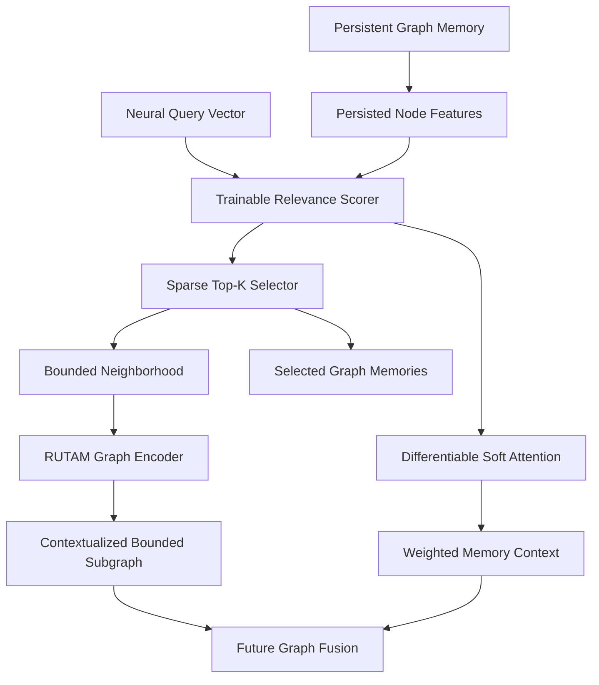

The default forward path scores persisted node features first, then relationally
encodes only the selected bounded neighborhood. Candidate ranking and top-k order
are discrete; selected-score recomputation can carry gradients when consumed by a
loss. The standalone selector API still accepts `GraphEncoderOutput` or raw node
states with the matching `GraphState.node_ids`; this is a lower-level API and does
not change the sparse-first order used by the default model forward path.

### Configuration and public interfaces

`RUTAMConfig.selector` defaults to:

```yaml
selector:
  query_dim: 128
  hidden_dim: 128
  score_dim: 128
  scoring_method: scaled_dot
  top_k: 16
  selection_mode: hard
  temperature: 1.0
  normalize_vectors: false
  chunk_size: 4096
  return_attention: false
  max_dense_elements: 1000000
```

Dimensions and K must be positive integers, temperature finite and strictly
positive, and chunk_size either a positive integer or null. Null removes the
requested chunk cap; the memory budget can still reduce the effective chunk size.
Scoring methods are `scaled_dot` and `additive`; modes are `hard` and `soft`.
The boolean settings reject non-booleans. Previous YAML and schema-v1 snapshots
without a selector section still load with defaults, preserving graph storage.
Encoder H must match selector hidden_dim at call time; query_dim is independent
of the unverified LFM3 hidden size.

`RUTAMGraphSelector(config.selector)(queries, encoded, state.node_ids, ...)`
accepts CPU float32 `query_states: [B,Q]` and `node_states: [N,H]` (or the actual
`GraphEncoderOutput`). IDs are unique nonnegative CPU int64 `[N]`, not necessarily
sorted for standalone tensor inputs. Optional boolean `node_mask: [N]` and
`eligibility_mask: [B,N]` are intersected. Masked nodes cannot be returned as
selected memories or receive positive attention probability.

`GraphSelectorOutput` provides:

| Field | Shape / dtype | Padding and availability |
|---|---|---|
| `selected_indices` | `[B,K]` int64 | Original row positions; padding -1 |
| `selected_node_ids` | `[B,K]` int64 | Persistent identifiers; padding -1 |
| `selected_states` | `[B,K,H]` float32 | Zero padding |
| `selected_scores` | `[B,K]` float32 | Temperature-scaled logits; zero padding |
| `selection_mask` | `[B,K]` bool | True only for selected eligible nodes |
| `attention_weights` | `[B,N]` float32 | Only when requested; otherwise None |
| `memory_context` | `[B,H]` float32 | Soft mode only; otherwise None |
| `relevance_logits` | `[B,N]` float32 | Soft mode or requested attention; otherwise None |
| `eligible_mask` | `[B,N]` bool | Accompanies dense relevance_logits |

Masked exported relevance logits are zero, so **pass eligible_mask into the loss**;
zero logits alone do not mean a node is ineligible. Padding scores can exceed
negative real logits numerically: selection_mask is authoritative. Outputs are
finite; internal negative-infinity masking sentinels never escape. Empty graphs
and fully masked samples produce only padding, zero attention, and a zero soft
context. They are not fabricated memories. Empty query batches are also supported.

### Scoring and stable hard selection

`NeuralRelevanceScorer` has bias-free query/node projections into shared S-space:

```text
u = Wq query; z = Wn node
scaled_dot: logits = (u dot z) / sqrt(S) / temperature
additive:   logits = v dot tanh(u + z + b) / temperature
```

With normalize_vectors enabled, projected vectors are L2-normalized before
scoring, with epsilon 1e-12 and float64 norm computation to handle large finite
norms. Zero vectors stay zero. Temperature affects soft probabilities and loss
gradients; positive temperature preserves ranking in exact arithmetic. Invalid
shapes/dtypes and nonfinite inputs/arithmetic raise ValidationError.

Public scorer methods include forward, project_queries, project_nodes,
score_projected and score_pairs. Standalone forward returns dense `[B,N]` logits;
use the selector's chunked path for large graphs. `masked_softmax` normalizes
globally over eligible nodes and gives exactly zero probabilities on masked
nodes and all-masked rows, with finite gradients.

`stable_topk` returns `TopKSelection`. It uses stable PyTorch sorts: ascending
persistent ID as the secondary key, descending score as the primary key. No
epsilon is added to scores, so near-ties are not changed. K is fixed even when
N<K or fewer eligible nodes exist. IDs remain int64 throughout, including large
IDs that cannot be represented exactly as floats.

Hard selection merges each chunk with the current K winners; retaining those K
is sufficient for the exact global top-k under the same ordering. This is not
approximate nearest-neighbor search. Floating-point GEMM/reduction ordering can
cause ordinary rounding differences between chunk sizes near numerical ties;
ID tie-breaking applies to exactly equal computed logits.

### Gradients and supervised objectives

Discrete indices/ranking have no gradient. A loss using only hard gathered states
can train those node representations/the encoder, but cannot train the scoring
projections through ranking. Hard mode without attention makes a no-grad ranking
pass and then **recomputes the winning scores with autograd**. A selected-score
loss therefore trains scoring projections and selected states, with the same
mathematical gradient as gathering scores from dense logits. Losing chunks do
not retain autograd graphs. This is an explicit two-pass implementation, not a
straight-through estimator or a detached substitute for soft attention.

In soft mode, `memory_context = masked_softmax(logits) @ node_states` is fully
differentiable through all eligible scores and features. Chunk scores are
concatenated before one global softmax; normalization is never done independently
per chunk. The exposed hard top-k in soft mode is an inspection output, while
memory_context is the differentiable read. Requested attention remains
differentiable even in hard mode. No graphs are silently detached in dense paths.

`node_retrieval_loss(logits, targets, mask=..., ignore_unlabeled=False)` supports
int64 `[B]` correct **row offsets**, or boolean `[B,N]` multi-positive targets.
Multi-positive loss is `logsumexp(eligible logits) - logsumexp(positive logits)`,
the negative log of the total probability assigned to any positive node. A single
positive gives ordinary cross-entropy. It is not mean cross-entropy over positives.
Targets outside the graph or on ineligible nodes always raise. Use -1 for an
unlabeled single target; empty-positive rows are ignored only when the explicit
ignore_unlabeled flag is true. The mean is over labeled samples only.

`attention_supervision_loss` computes mean `KL(teacher || student)`. Teacher
probabilities must be nonnegative, finite, correctly shaped and normalized over
eligible nodes (within numeric tolerance). Positive teacher mass on invalid nodes
is rejected. An all-zero teacher row is unlabeled and requires the same explicit
ignore flag. Zeros are handled without log(0) NaNs. Both losses use centered
float64 log-sum-exp arithmetic, return float32 scalars, and return differentiable
zero when every row is explicitly ignored. Neither function is a training engine.

Train using dense logits in soft mode or requested-attention mode, or by calling
the scorer directly. Hard winner scores alone omit nonselected negatives and are
not a replacement for full retrieval supervision. Teacher support here is only
a reusable objective; no DeepSeek API or distillation is implemented.

### Parameter counts, CPU bounds and remaining work

The default scaled-dot selector has **32,768** trainable parameters:
`S*(Q+H)`. Additive scoring adds S bias values and S readout values, for **33,024**.
K, masks, IDs, normalization and sorting add no parameters. The default encoder
and scaled-dot selector together have 152,704 parameters; additive gives 152,960.
These are separate neural weights, never added to graph.safetensors.

Projection/scoring arithmetic costs approximately `O(B*Q*S + N*H*S + B*N*S)`.
Stable chunk merging sorts up to C+K candidates per query per chunk, costing
`O(B*N*log(C+K))` for the usual C>=K case. ID uniqueness validation separately
sorts N IDs. Hard output state storage costs `O(B*K*H)`; forward scoring workspaces
use `O(C*S + B*C)` for dot scoring and `O(B*C*S)` for additive scoring, plus merge
buffers and the selected-score recomputation. Node input validation is linear in
N*H and can allocate a corresponding boolean finite-value buffer. The caller's
node states, masks and upstream encoder autograd storage remain additional costs.
No `[N,N]` adjacency is created; hard mode without attention also avoids `[B,N]`.

The effective hard chunk is reduced to honor max_dense_elements for projected
chunks/scoring work. Soft mode or requested attention explicitly rejects work
when `max(B*N*F, N*S)` exceeds the limit, with F=S for additive and F=1 for dot.
This conservatively accounts for additive hidden activations and stored projected
nodes, not just attention cells. Hard selected-score workspace B*K*S is also
checked. The budget constrains these scoring workspaces, not merge buffers, total
process RAM or all autograd/optimizer state. It is configurable and no full-capacity speed/RAM
benchmark is claimed. For large-graph differentiable attention, a correct streaming
softmax/backward or sampling design remains future work; this phase fails clearly
instead of silently detaching or applying chunk-local normalization.

The module is CPU float32, single-graph/multi-query, and assumes IDs match the
provided row order. No full-backbone integration, cross-attention fusion, multi-hop neural
traversal, new memory writing, recurrent loop, fine-tuning pipeline or distillation
is included. The phase 04 query head is described below.

Run `uv run python examples/select_graph.py` for the ten-node/two-query smoke
test. It uses a seeded random encoder, identity selector projections and two
encoded node vectors as query prototypes. Different selected IDs demonstrate
tensor selection behavior, not semantic retrieval quality or model training.

## Native neural query head — implemented in phase 04

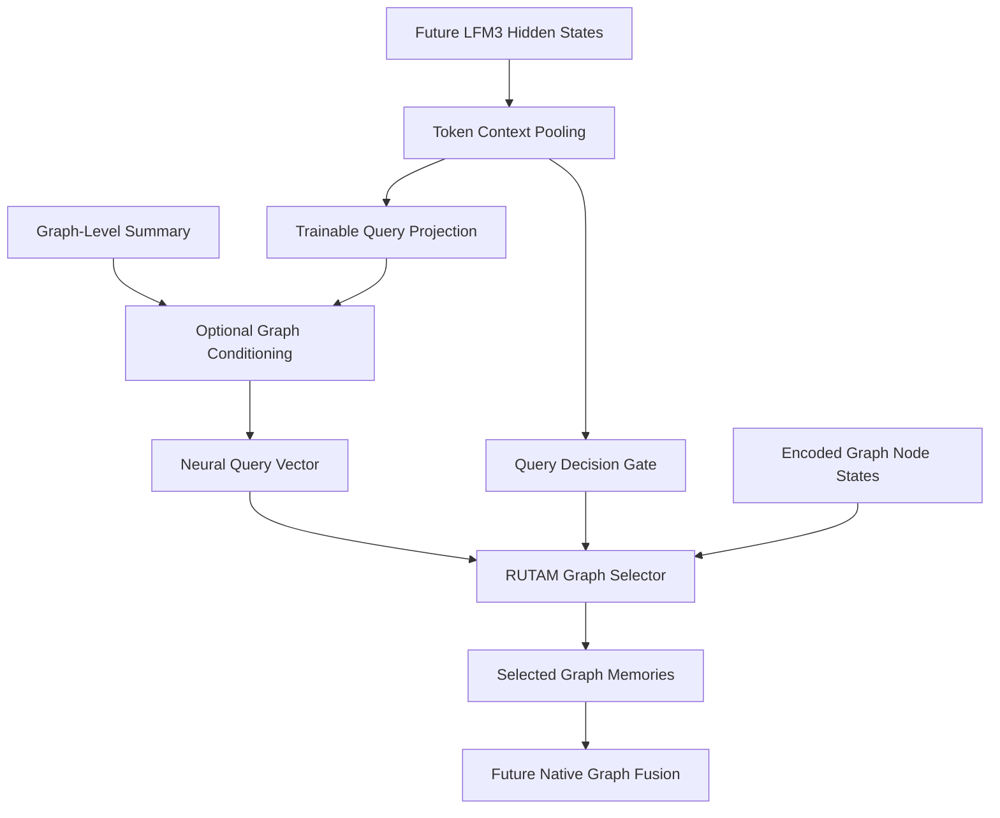

### Inputs, outputs and batch semantics

`RUTAMNeuralQueryHead` consumes CPU float32 `hidden_states: [B,T,D]`, an optional
boolean `attention_mask: [B,T]`, optional float32 `graph_summary: [H]` or `[B,H]`,
and optional boolean `memory_available: [B]`. D is backbone_hidden_dim, H is
graph_hidden_dim, Q is query_dim, and M is intermediate_dim. None of these
dimensions is inferred from undocumented model attributes. Defaults D=256,
H=128, Q=128, M=256 are synthetic development dimensions.

`QueryHeadOutput` provides:

| Field | CPU shape / dtype | Semantics |
|---|---|---|
| `query_vectors` | `[B,Q]` float32 | Continuous, optionally normalized queries |
| `query_gate` | `[B,1]` float32 | Continuous utility score, forced zero when ineligible |
| `query_gate_logits` | `[B,1]` float32 or None | Raw pre-sigmoid logits for supervision |
| `query_confidence` | `[B,1]` float32 property | Uncalibrated alias of query_gate |
| `should_query` | `[B]` bool or None | Hard decision in eval mode; None in training |
| `token_attention_weights` | `[B,T]` float32 or None | Optional inspection of pooling weights |
| `valid_context` | `[B]` bool | Real token context versus explicit zero fallback |

One `[H]` graph summary broadcasts across query samples. `[B,H]` supplies a
separate summary per sample; `[1,H]` does not implicitly broadcast to a larger
batch. The current selector still reads one shared graph per call; batched
summaries do not add multi-graph batching. Summary provenance and chronology
remain the caller's responsibility.

Standalone forward assumes available memory if memory_available is omitted.
A zero graph summary does not imply an empty graph: valid node states can pool
to zero. Supply the availability mask explicitly or use select_graph, which
derives it from node count, validity/eligibility masks and an optional external
availability restriction. Graph data is never modified or saved.

### Token context pooling

`QueryPooling` implements three methods:

- `last_valid`: use `max(position where mask=True)`, handling left padding,
  right padding and gaps. It never assumes `sum(mask)-1` is a token position.
- `mean`: average valid hidden states only, dividing before summation. Padding
  contributes exactly zero.
- `attention`: learn one bias-free D-to-1 token scorer and normalize its logits
  using the existing stable masked softmax. This is O(B*T*D), not token-pair
  self-attention. Gradients reach token importance weights and hidden states.

Inspection weights are one-hot for last_valid, uniform over valid tokens for
mean, and learned for attention. They are optional in every mode. A missing mask
means every token is valid. Masks must be boolean; external model adapters must
convert their documented mask format explicitly.

All-masked or length-zero sequences raise by default. Set
empty_sequence_policy=zeros to explicitly obtain a zero context, zero query,
zero gate and False inference decision for those samples. Inspection weights
are zero, and the valid_context flag stays False. Empty batch B=0 is supported.
All input values, including padding, must be finite.

### Query projection and graph conditioning

With pooled context c:

```text
u = LayerNorm(c)
q_base = W2 dropout(GELU(W1 u + b1)) + b2
```

W1 maps D to M, W2 maps M to Q. Optional residual connections add c only when
D=Q. For unequal dimensions, residual_projection must explicitly enable a
trainable bias-free D-to-Q skip projection. There is no silent dimension guess.

If an existing graph summary g is supplied and graph conditioning is enabled:

```text
g_query = W_graph g                         # H -> Q, no bias
add:       q = q_base + g_query
gated_add: q = q_base + sigmoid(Wc [q_base; g_query] + bc) * g_query
```

The conditioning gate is a trainable scalar per sample. Unavailable memories
zero the summary contribution before projection. Missing summaries skip this
path; disabling graph_conditioning removes its parameters. Supplied summaries
are still shape/dtype validated when conditioning is disabled. This pathway
uses only a pre-existing pooled graph representation. It never requires selected
nodes or runs selection before building the query, so no circular dependency is
introduced. It cannot enforce chronology or prevent leakage in caller-supplied
tensors; callers must not provide future-answer summaries during training.

Optional L2 normalization is applied after residual/conditioning using float64
norm computation and epsilon 1e-12, then returns float32. Zero/near-zero vectors
remain safe. Fallback samples are explicitly zeroed after projection. Finite
inputs/intermediates are validated, and overflow raises ValidationError instead
of silently returning NaNs. CPU float32 is the supported execution contract.

### Utility gate, losses and gradient behavior

`QueryDecisionGate` computes:

```text
gate_input = [c; availability]       # omit availability feature when configured
gate_logits = Wg2 GELU(Wg1 gate_input + bg1) + bg2
query_gate = sigmoid(gate_logits) * effective_availability
```

The gate's intermediate width is M. Effective availability also requires a
valid token context. The availability input feature is optional, but forced
masking of unavailable reads always applies. Raw logits remain finite and
unmasked for supervision. During training, should_query is None and gate values
remain continuous; no threshold or detach is inserted into this path. In eval
mode, should_query is `available AND gate>=gate_threshold`. Even threshold=0
cannot enable unavailable memory. `.eval()` does not disable autograd; callers
may additionally use torch.no_grad for inference.

If query_gate_enabled is False, the gate is an explicit available-only bypass:
no gate parameters/logits exist, and available samples get gate=1. This is not
a learned score. The default gate is trainable. query_confidence is only an
uncalibrated alias of the utility score, not a calibrated certainty estimate.

`query_decision_loss` uses BCE-with-logits and binary labels 1=useful, 0=unnecessary.
It accepts `[B]` or `[B,1]` boolean/int64/float32 labels and optional boolean `[B]`
sample masks. Pass raw query_gate_logits. Forced availability masking does not
implicitly mask this loss: callers explicitly decide whether unavailable or
fallback samples should contribute. Disabled gates have no logits to supervise.
An empty/fully excluded batch yields differentiable zero. Arithmetic is evaluated
in float64 and returned as a finite float32 scalar for numerical stability.

Reuse node_retrieval_loss on selector logits to train the query projection and
pooling against known relevant node rows. Retrieval logits alone do not train
the decision gate. Gate BCE or a downstream loss through a gated soft context
provides that signal. All losses are reusable functions; no training pipeline,
distillation or backbone fine-tuning is implemented.

normalize_queries supplies a unit-length constraint without penalizing every
query toward zero. Optional query_norm_loss uses `(sum(q^2)-1)^2`, weighted by
norm_regularization_weight through head.regularization_loss(output), excluding
fallback contexts. The default weight is zero. Magnitude constraints do not
guarantee diverse queries, prevent identical unit vectors, or teach relevance;
input-dependent retrieval supervision and later evaluations remain necessary.

### Minimal selector composition

`head.select_graph(hidden, selector, encoded, node_ids, ...)` returns
`QuerySelectionOutput(query, selection, gated_memory_context)`. It accepts the
existing GraphEncoderOutput and its summary without changing that interface.
The standalone path head.forward(...).query_vectors -> selector also works.
QueryHeadConfig.validate_selector checks Q explicitly; the head constructor can
take selector_config for early checking, and select_graph always checks the
actual selector. Graph-summary width is checked on tensors. Cross-component
checks occur when components are combined, preserving older graph-only YAML
and schema-v1 snapshots with different neural dimensions.

During training, all available samples remain eligible regardless of whether
their continuous gate is above 0.5. In soft selector mode the helper exposes
`gated_memory_context = selection.memory_context * query.query_gate`, preserving
gradients through query generation, graph encoding, scoring and the utility gate.
Inference additionally intersects selector eligibility with should_query. Empty
graphs or all-invalid nodes yield no selected IDs and a zero gated context.
Hard selector mode has no soft memory context and retains the existing discrete
ranking limitations; gate supervision remains possible through raw logits.

This adapter implements logical eligibility masking rather than compute routing:
it creates a `[B,N]` boolean eligibility table and may still score declined rows.
The selector's existing dense-soft/attention workspace limits still apply.
Batch compaction, conditional compute skipping and model-side fusion are future
optimizations, not claimed features of this minimal adapter.

### Parameters, CPU costs and integration limits

With the default synthetic configuration:

| Trainable part | Parameters |
|---|---:|
| Attention pooling | 256 |
| LayerNorm and query projection MLP | 99,200 |
| Graph-summary projection and conditioning gate | 16,641 |
| Query decision gate, including availability input | 66,305 |
| **Query head total** | **182,402** |

The encoder + scaled-dot selector + query head total 335,106 parameters. Optional
features change this count; graph data and future backbone/fusion weights are
excluded. Core projection count is `2D + D*M + M + M*Q + Q`, attention adds D,
graph projection adds H*Q and its scalar conditioning gate adds 2Q+1. The enabled
decision gate adds `(D+A)*M + M + M + 1`, where A=1 when the availability input is
enabled. A learned residual adds D*Q. None of these neural parameters is placed
in graph.safetensors; ordinary separate state_dict checkpoints remain appropriate.

Pooling costs O(B*T*D), projection O(B*(D*M+M*Q)), conditioning O(B*H*Q+B*Q),
and the utility gate O(B*(D+A)*M). Working activations include O(B*T*D) pooling
products and O(B*M+B*Q) projected states; there is no O(T*T) attention matrix.
The integration eligibility mask adds O(B*N); graph encoder/selector costs and
their autograd buffers remain additional. CPU tests use tiny synthetic tensors,
and no full-sequence/full-graph memory or throughput benchmark is claimed.

No actual LFM3 model is loaded, wrapped, modified or verified. A later adapter
must obtain hidden tensors through the released model's supported API and set D
from verified configuration, then define query/fusion placement. This phase does
not choose layer names, add cross-attention, write graph memories, run recurrent
backbone loops or call teacher/cloud services. Phase 05 traversal is a separate module.

Run `uv run python examples/query_graph.py`. With the documented seed, both
synthetic inputs produce different queries; the first random gate declines access
and the second selects IDs [179,166,192]. Weights are unedited, untrained and
uncalibrated. This is not evidence that both inputs learned distinct retrieval;
utility and relevance require training and evaluation.

## Milestone 05 — bounded native graph traversal

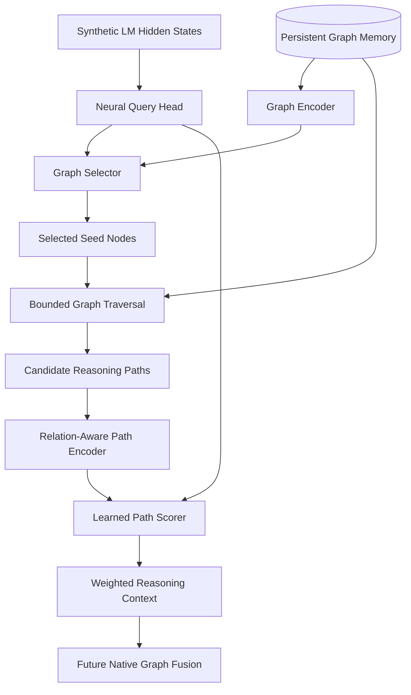

`RUTAMGraphTraversal(TraversalConfig(...))` is an nn.Module. Its direct forward
inputs are query_vectors `[B,Q]`, node_states `[N,H]`, edge_index `[2,E]`,
edge_types `[E]`, edge_weights `[E]`, seed_indices/seed_mask `[B,K]`, and stable
node_ids `[N]`. Floating tensors are CPU float32, IDs/indices are CPU int64 and
masks are boolean. No implicit device moves occur. Forward supports an optional
graph_version, a global node validity mask and a direction override.

`traversal.from_state(queries, encoded, state, seed_indices, seed_mask)` accepts
the existing GraphState and GraphEncoderOutput or raw node states. An undirected
stored graph is traversed in both directions without modifying its canonical
edge storage. For the complete native pathway:

```python
encoded = encoder(state)
read = query_head.select_graph(hidden, selector, encoded, state.node_ids)
reasoning = traversal.from_state(
    read.query.query_vectors,
    encoded,
    state,
    read.selection.selected_indices,
    read.selection.selection_mask,
)
gated_reasoning_context = reasoning.reasoning_context * read.query.query_gate
```

No text is generated or inserted into prompts, and the model backbone is not
loaded. The caller explicitly applies a continuous query gate to the reasoning
context during training if desired. In inference, the existing query adapter
already masks declined seeds.

### Sparse indexing and bounded enumeration

`NeighborhoodCache` prepares immutable SparseNeighborhood indexes with outgoing
and incoming adjacency lists and a typed-edge set. Construction/validation costs
O(N+E), plus sorting each adjacency list by neighbor persistent ID and relation
ID. `neighbors(row, direction, limit)` accesses indexed incident edges; it never
constructs N-by-N adjacency. Reverse traversal retains the original relation ID
and adds direction -1; it does not invent an inverse relation label. Both-direction
mode avoids doubling a self-loop.

An index cache entry requires both a graph mutation version and a SHA-256 digest
of integer node IDs, edge indices and relation IDs. The full O(N+E) digest is
checked each call, catching in-place topology changes and reused version numbers.
Without a version, the index is rebuilt rather than assumed fresh. Weights/features
are not cached or detached: neural computation gathers the live tensors. Cache
preparation is ordinary CPU topology work outside autograd, not learned retrieval.

`enumerate_paths` uses BFS over simple path prefixes. Active seeds are validated,
deduplicated and, with deterministic=True, sorted by persistent ID. Duplicate
endpoints can occur in different candidate paths, but reported visited nodes are
globally deduplicated. A node cannot repeat within a path, so cycles terminate.
Parallel edges with different relation IDs remain distinct paths. Disconnected
components outside the bounded seed expansion are not visited.

Budgets independently bound hops, incident neighbors per expansion, distinct
visited nodes, candidate prefixes, selected debug paths and padded path workspace.
Seed roots consume the visited-node budget even when include_seed_nodes=False;
that setting omits singleton paths and root nodes from reported visits. When True,
seed-only paths are valid zero-hop candidates. Deterministic=False preserves input
seed order rather than adding stochastic exploration; adjacency ordering stays
canonical. Truncation favors lower-ID prefixes, not necessarily the most relevant
unseen path. Large hop/fanout/candidate settings emit a combinatorial-growth warning;
budgets still stop enumeration, and oversized tensor workspaces raise ValidationError.

### Ordered neural path encoding and scoring

`RUTAMPathEncoder` projects graph hidden states H into path_hidden_dim Dp. For
path nodes n0,...,nl and stored edges e1,...,el:

```text
token_0 = W_node h(n0) + b_node + hop_embedding(0)
token_j = W_node h(nj) + b_node + hop_embedding(j)
          + W_relation relation_embedding(type(ej))
          + direction_embedding(forward_or_reverse)
          + W_weight log1p(weight(ej))       # optional
state_j = GRUCell(dropout(token_j), state_(j-1))
path_representation = optional_linear_Dp_to_H(last_valid_state)
```

The GRU is a bounded path sequence encoder, not a recurrent language-model
reasoning loop. Masked updates preserve the previous hidden state, so padding
cannot affect the representation. RelationEmbedding is the existing typed module;
an encoder's relation_embeddings can be explicitly shared when vocabulary and H
match. Direction, hop order, relation order and edge weights affect neural features;
no hardcoded semantic reasoning rules exist. Edge weights use log1p for scale
control and remain differentiable.

`RUTAMPathScorer` reuses NeuralRelevanceScorer for additive or scaled-dot relevance.
Cosine scoring normalizes query/path projections and removes the dot scorer's
sqrt(S) factor. Scoring can run in path chunks; one global masked softmax follows
concatenation, preserving correct normalization and gradients. Deterministic top-k
debug selection uses canonical candidate ordinals as tie-break keys.

Default reasoning_context is the soft weighted sum over **all eligible bounded
candidates**, not just the debug top-k. max_selected_paths bounds the separate
inspection list. This keeps a differentiable read over the enumerated candidate
set while preserving exact hard top-k diagnostics. Padded logits/features/attention
are zero; an empty candidate set gives an exactly zero `[B,H]` context.

### Output contracts and supervised objectives

`TraversalOutput` uses V=max_visited_nodes, P=max_candidate_paths, L=max_hops:

| Output | Shape | Padding/meaning |
|---|---|---|
| visited_indices / visited_node_ids | `[B,V]` | Row offsets / stable IDs; -1 padding |
| visited_mask / node_relevance_scores | `[B,V]` | Bool validity / endpoint attention mass |
| path_representations | `[B,P,H]` | Zero for padded paths |
| path_scores / path_attention / path_mask | `[B,P]` | Logits / global attention / validity |
| reasoning_context | `[B,H]` | Differentiable weighted path read |
| selected_path_indices / selected_path_mask | `[B,S]` | Candidate-row offsets / validity |
| path_node_indices / path_node_ids / path_node_mask | `[B,P,L+1]` | Ordered row offsets / IDs / mask |
| path_edge_indices / path_relation_ids / path_directions / path_edge_mask | `[B,P,L]` | Stored edges/types, +/-1 directions, mask |
| path_ids / endpoint_node_ids | `[B,P]` | Candidate-local IDs / stable endpoint IDs |

Indices, IDs and relation IDs pad with -1; directions pad with zero. Masks are
authoritative. Node relevance is attention mass summed over paths ending at each
reported node, not a calibrated independent node probability. graph_version and
topology_fingerprint bind diagnostics to prepared topology. Candidate path IDs
are deterministic ordinals local to this batch/snapshot/seed/configuration, not
globally persistent path identities. Node IDs inside paths remain persistent.

`path_retrieval_loss` supports one or multiple positive path IDs via path_ids,
or row-index/boolean targets using the existing retrieval objective. It uses
marginal log-likelihood, not average CE over alternative positives.
`endpoint_supervision_loss` marginalizes all paths ending at target node IDs:
reaching a correct endpoint is explicitly different from identifying a correct
reasoning path. Unknown targets are errors; -1/unlabeled samples can be ignored
only explicitly. `pairwise_path_ranking_loss` applies a nonnegative margin to
positive/negative candidate row indices with paired -1 padding. All losses remain
separate from a training engine and do not establish general reasoning ability.

Neural gradients reach query projections, path scorer, GRU, node representations,
relation/hop/direction embeddings and used edge weights. BFS, seed selection,
candidate enumeration, index preparation and path top-k decisions are discrete.
No straight-through estimator is used. A hard selected seed cannot train selector
ranking through the traversal, although shared query and graph-encoder tensors
can still receive gradients through the path network.

### CPU costs and limits

Enumeration is bounded by roughly O(B*(K + P*neighbor_cap)*path_length), aside
from index preparation and deterministic ordering. Padded neural work costs
O(B*P*(L+1)*Dp^2), with projected node/relation features and an output projection
when Dp differs from H. Path scoring costs O(B*P*(H*S+S)); workspace limits cover
padded path features and visited outputs. There are no all-pairs node interactions.
The default traversal has **170,112 trainable parameters**: 137,088 in its path
encoder and 33,024 in the additive path scorer. Independent relation embeddings
are included; sharing the existing encoder table reduces combined unique counts.

The cache contains one snapshot and still performs a content check each call.
Simple-path prefixes cannot express repeated-node walks. BFS is not query-guided
beam search. Budgets can omit a relevant path, and local path IDs must not be
reused after a snapshot/seed/config change. Caller-supplied encoded states/seeds
must match the current snapshot: older encoder/selector outputs have no embedded
version field. This phase adds no language-model fusion or recursive model loop.
Run `examples/traverse_graph.py` for the 8-node/10-edge demonstration and an actual
10-call warmed CPU timing. Its output is a smoke measurement, not a scaling benchmark.

## Milestone 06 — neural link proposals and relation discovery

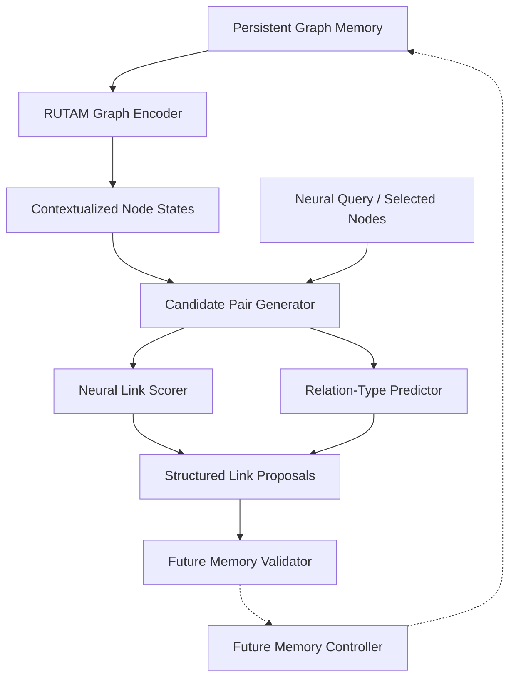

`RUTAMGraphLinker` accepts CPU float32 node_states `[N,H]`, stable int64 node_ids
`[N]`, edge_index `[2,E]`, edge_types `[E]`, and optional explicit pair row offsets
`[C,2]`. `from_state(encoded, state, ...)` accepts existing GraphEncoderOutput or
raw states, validates the actual graph vocabulary/direction policy, and supplies
snapshot version, node types and node provenance. Neither API loads/saves graph
files or modifies confirmed graph data.

### Bounded discrete candidate generation

`generate_link_candidates` offers neighborhood (one/two hop), exactly two-hop,
selected-anchor-to-target pairing, bounded embedding similarity, and explicit
pairs. Candidates deduplicate deterministically and sort by persistent source
ID, then destination ID. Self-pairs are excluded by default; explicitly supplied
self-pairs raise unless allowed. Invalid references are errors. Node masks exclude
ineligible candidates. Neighbor, expansion-attempt and unique-pair budgets bound
work; hitting a budget conservatively marks candidates_truncated. Explicit inputs
larger than max_candidate_expansions are rejected before Python enumeration.

Similarity requires explicit anchors within max_similarity_anchors. It computes
raw feature cosine similarities in node chunks, retains exact global top neighbors
per anchor with stable ID ties, and creates no N-by-N matrix or external index.
It is discrete candidate preparation under no_grad; original node tensors are
still used by differentiable neural scoring. Selected indices are a **shared 1-D
anchor list**, not silently flattened per-query selections. Callers can explicitly
form a union when sharing candidates across queries.

Pairs with an existing relation remain candidates for another possible relation.
Only an identical predicted **typed directed edge** suppresses a proposal. This
distinguishes duplicate edges from multi-relational evidence. Directed candidates
retain source/destination order. Undirected mode canonicalizes pairs by stable
ID and uses symmetric node-interaction features; both orientations count as an
existing edge. from_state rejects a direction-policy mismatch.

`structural_link_features` returns `[C,4+M]`, with M real relation labels:
log1p(shared outgoing-neighbor count), directed two-hop connectivity, existing
reverse edge, configured node-type compatibility, and global relation frequencies.
Undirected mode uses incident-neighbor sets. Compatibility means a configured
type pair matched, not a proof of truth; zero can mean no rule was provided.
These compact features enter learned projections, never absolute rejection rules.

### Neural scoring, relation schema and parameter counts

`RUTAMLinkScorer` and `RUTAMRelationPredictor` have independent trainable feature
networks. Directed pair features are `[u,v,u*v,abs(u-v)]`, followed by LayerNorm,
optional projected structural features, optional projected query, a GELU/dropout
hidden layer and separate output heads. Undirected node interactions instead use
`[u+v,u*v,abs(u-v),u^2+v^2]`. Link logits map to sigmoid probabilities; relation
logits map to a softmax including NO_RELATION. Positive link/relation temperatures
are configurable for later calibration, but defaults are not calibrated scores.

The default independent link scorer has **136,913** parameters, relation predictor
**138,969**, and linker total **275,882**. These counts use H=128, hidden width=256,
8 real relation labels, NO_RELATION, and a 16-wide structural projection, without
query conditioning. Features/labels/graph IDs are not trainable parameters.

`RelationVocabulary` explicitly distinguishes classifier classes and graph types:
class **0 = NO_RELATION**, and real class **r+1 maps to persistent graph relation
ID r**. `labels`, `name`, `class_id` and `graph_relation_id` expose this mapping.
Configuration relation_labels contains only real labels, in graph-ID order.
The default eight example labels are schema choices, not semantic facts.
from_state validates names and IDs against the configured vocabulary; it never
silently remaps an unknown graph schema. RelationVocabulary.from_state can derive
a vocabulary from existing contiguous graph IDs. Sparse custom ID maps require
a complete explicitly configured vocabulary rather than fabricated gap labels.

`extend`, predictor.migrate and linker.migrate_relation_types are explicit
append-only schema migrations. Existing real graph IDs, class IDs and learned
rows remain stable; NO_RELATION stays at class 0. Old classifier logits are
preserved, new classifier rows start untrained, and added structural-feature
columns start at zero weight. Softmax probabilities may change when new classes
are introduced. A schema-signature tensor in checkpoints prevents equal-sized
but differently named/versioned vocabularies from silently loading. Save the
matching model configuration with a separate neural checkpoint. No schema
migration commits edges or changes backbone/encoder weights automatically.

### Output/proposal contracts and consistency

Unconditioned LinkerOutput has shared candidate_pairs/candidate_node_ids `[C,2]`,
link_logits/probabilities `[C]`, relation_logits/probabilities `[C,R]`, predicted
relation classes `[C]`, predicted graph relation IDs `[C]`, confidence/masks `[C]`,
and structural_features `[C,4+M]`. R=M+1 includes NO_RELATION. With
query_conditioning=True, query_vectors is explicitly `[B,Q]`, and neural output
fields gain a leading B dimension (`[B,C]` and `[B,C,R]`). Pairs/structure remain
shared `[C,...]`. Query masks can suppress complete samples. Empty candidates
and empty batches have correctly shaped finite outputs.

predicted_relation_types holds **class IDs**; predicted_graph_relation_ids holds
real graph IDs, with -1 for NO_RELATION or masked candidates. Invalid neural
outputs are zero-padded, masks are false and invalid class IDs are -1. Class 0
on a valid pair is an actual NO_RELATION prediction, not padding.

Proposal confidence is the heuristic product
`sigmoid(link_logit) * softmax(relation_logits)[predicted_class]`, zero for
NO_RELATION. It is not a calibrated joint probability or a factual-confidence
guarantee. Independent link/relation thresholds and a global per-call proposal
budget filter predictions. The budget is global across query batches; ties use
batch index and persistent source/destination IDs. proposal_batches explicitly
groups proposals by query (one group when unconditioned); no hidden batch flattening
occurs in model tensors. proposal_mask identifies emitted proposals after budgets.

`LinkProposal` carries stable source/destination IDs, persistent relation ID/name,
link/relation scores, combined confidence, evidence references, graph version,
topology fingerprint, relation-schema version, UTC timestamp, validation status,
conflict annotations and optional batch index. Status can only be unverified or
conflict_review; a prediction cannot be constructed as confirmed through this
type. Evidence references are preserved strings, not independently verified facts.
from_state attaches source/destination provenance by default, without any dense
N-by-N provenance map. Caller-supplied evidence uses persistent-ID pair keys.

Annotations distinguish identical_typed_edge, reverse_edge_present,
opposite_direction_same_relation and other_relation_present. Only explicitly
configured conflicting_relations produce conflicting_relation_evidence. Opposite
directions or different types are not automatically treated as semantic
contradictions. Conflicting proposals can be returned for review; no existing
edge is deleted, merged or overwritten. Raw logits remain available for supervised
learning even if proposal filters reject an argmax prediction.

expected_graph_version rejects stale requests. validate_proposal_snapshot checks
mutation version, topology fingerprint, schema version and node/type references;
it is structural freshness validation, never factual confirmation or a commit.
Graph mutation counters are scoped to a graph; the fingerprint additionally
distinguishes different topologies with the same counter. Callers must still pair
encoded states with their source snapshot and track model/configuration versions.

### Losses, sampling and CPU limits

binary_link_prediction_loss is stable BCE-with-logits with configurable positive
class weighting. relation_classification_loss is CE over classes including
NO_RELATION. With binary labels supplied, nonexistent links cannot receive positive
real relation labels (and positive links cannot target NO_RELATION) unless the
caller explicitly enables allow_unlinked_relations. Padded -1 class targets
require false masks. link_ranking_loss reuses the validated pairwise margin
objective. combined_link_loss returns total/link/relation/ranking terms using
LinkLossWeights; ranking is zero when explicit positive/negative ranking pairs
are not supplied. There is no automatic pseudo-labeling from proposals.

sample_negative_pairs uses a local seeded CPU generator, rejects any known
positive pair across all relation types, respects directed/self policies and
deduplicates results. It has a finite attempt budget and reports exhaustion when
too few samples are found. Undirected negatives exclude both orientations.
Unobserved pairs are **not known false facts**: negative sampling is a training
assumption whose label noise must be evaluated. Module.sample_negatives applies
the configured negative-to-positive ratio and pair/attempt budgets.

Candidate/index preparation, thresholds, argmax, proposal budgets and formatting
are discrete. Logits/probabilities, pair projections, relation classifier and used
node/query tensors remain differentiable. Gradients propagate through the existing
encoder, including relation embeddings. Proposal metadata deliberately contains
Python scalars/IDs; train from the returned tensors, not metadata conversions.

Indexing and feature preparation take O(N+E) space/work plus adjacency sorting;
feature set intersections depend on incident degrees. Candidate trials are capped
by max_candidate_expansions and max_candidate_pairs. Similarity costs O(A*N*H)
for at most A bounded anchors and chunked node workspaces. Neural scoring costs
O(B*C*(4H+F+Hquery)*S + B*C*S*R), with Hquery present only when conditioned.
Scoring can be chunked, but training retains activations; max_link_elements rejects
oversized aggregate candidate workspaces. No all-pairs node matrix is built.
This is a configurable workspace bound, not a total-process RAM guarantee.

Known limits: one shared candidate set per multi-query call, one argmax relation
proposed per pair, append-only schema migration, low-ID/budget candidate bias,
uncalibrated scores, potentially noisy sampled negatives, and no distributed
snapshot/concurrent-graph merge support. None of the neural code commits a link.
Run examples/propose_links.py for six nodes/eight typed edges; exploratory zero
thresholds expose untrained predictions and before/after checksums verify that
the saved graph remains unchanged. Default thresholds remain conservative.

## Milestone 07 — Native Memory Write Head

Developed in Phase 1 (Prompt 07/20). Implements `RUTAMMemoryWriteHead` and supporting
subsystems for neural memory mutation proposal generation, write gating, operation
prediction, slot embedding projection, target node compatibility scoring, and
multi-task write supervision without performing persistent storage commits.

### Architecture and Components

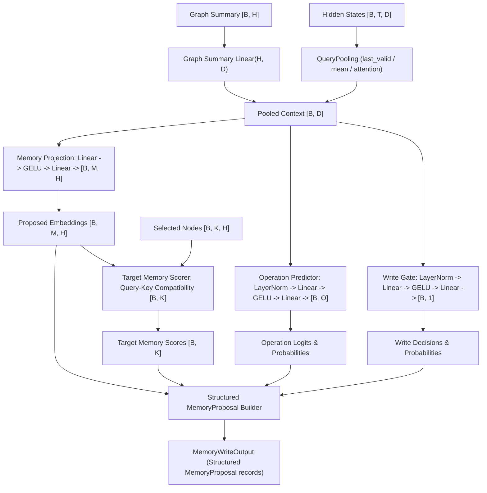

### Stable Memory Operations

Operation codes are versioned and stable (7 total):
- `NO_OP` (0): No mutation intended.
- `CREATE_NODE` (1): Propose creating a new memory node.
- `UPDATE_NODE` (2): Propose updating an existing selected node.
- `PROPOSE_LINK` (3): Propose establishing a relationship between candidate nodes.
- `PROPOSE_MERGE` (4): Propose merging redundant or complementary nodes.
- `SUPERSEDE_NODE` (5): Propose superseding an outdated node with a new candidate.
- `REQUEST_VALIDATION` (6): Flag state for higher-tier verification.

### Proposal Generation Contract

`RUTAMMemoryWriteHead` generates candidate `MemoryProposal` records.
The configuration setting `memory_write.commit_automatically` is enforced to remain `False`:
under no circumstances does the write head directly modify persistent graphs or write
snapshots to disk. Validation, conflict detection, provenance enforcement, and transactional
commits are delegated to downstream validation and transaction controllers (Milestones 08 & 09).

### Multi-Task Loss Formulation

Supervised write head training uses:
$$L = \alpha L_{\text{write}} + \beta L_{\text{operation}} + \gamma L_{\text{embedding}} + \delta L_{\text{target}}$$

- $L_{\text{write}}$: Binary Cross Entropy with Logits over binary write decisions.
- $L_{\text{operation}}$: Cross Entropy loss over the 7 operation classes.
- $L_{\text{embedding}}$: Cosine distance loss ($1 - \cos(\hat{e}, e)$) between proposed and target vectors.
- $L_{\text{target}}$: Cross Entropy or Binary Cross Entropy over candidate selected memory nodes.
- Masked sample evaluation and selective active-operation filtering are supported.

## Milestone 08 — Memory Validation & Integrity

Implemented in Phase 1 (Prompt 08/20). Implements `RUTAMMemoryValidator` and composable
subsystems for provenance verification, duplicate detection, contradiction/conflict detection,
security and privacy scanning, and optimistic concurrency version checking.

### Architecture and Validation Pipeline

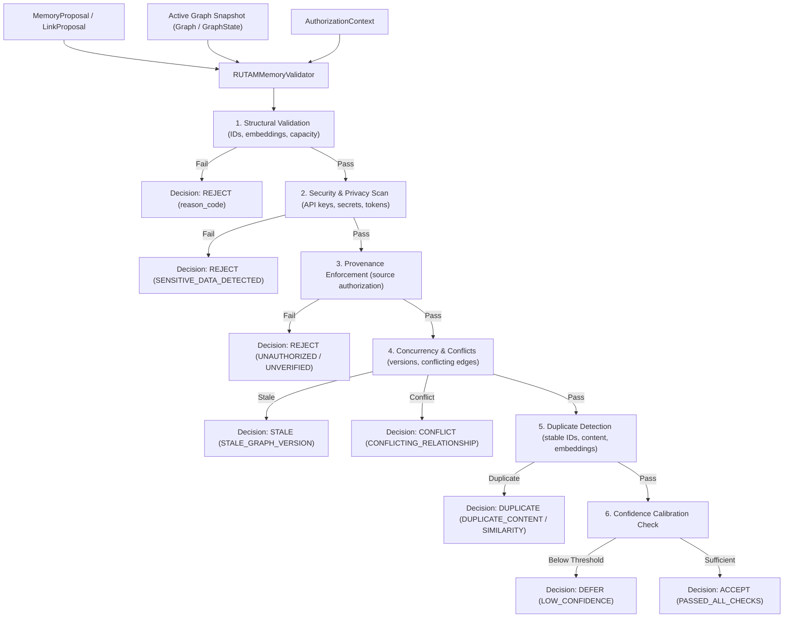

### Validation Invariants

1. **No-Commit Invariant:** The validator is strictly a read-only analysis engine. It evaluates proposals against live graph snapshots without ever modifying nodes, edges, versions, or persistent storage.
2. **Authority Invariant:** Neural confidence never overrides structural, provenance, or security failures. A proposal with 1.0 confidence that leaks a secret, references a missing node, or lacks authorization is unconditionally rejected.
3. **Optimistic Concurrency:** Proposals carry `source_graph_version`. If the active graph snapshot version has progressed beyond the proposal version, the proposal is flagged as `STALE`, preventing lost-update anomalies.
4. **Comprehensive Duplicate Detection:** Matches are caught via exact persistent IDs, whitespace/case-normalized text content, edge tuples `(src, dst, rel)`, and bounded cosine similarity (threshold default 0.98).

## Milestone 09 — Native Memory Controller

Implemented in Phase 1 (Prompt 09/20). Implements `RUTAMMemoryController` and supporting
pipelines orchestrating the complete lifecycle of neural graph memory: differentiable reading,
differentiable write proposal generation, discrete validation, and isolated atomic transactional
commits with audit logging.

### Architecture and Controller Lifecycle

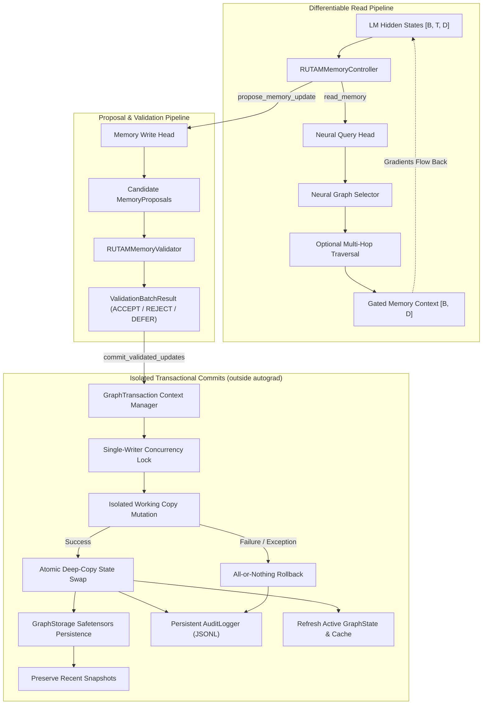

### Memory Lifecycle States

The controller tracks explicit lifecycle state transitions via `MemoryState`:
- `EMPTY`: Initial state when attached graph contains 0 nodes.
- `LOADED`: Persistent graph loaded from storage into memory.
- `READ_READY`: In the midst of executing differentiable read pipeline.
- `WRITE_PENDING`: In the midst of neural write proposal generation.
- `VALIDATING`: Evaluating staged proposals with discrete validation rules.
- `COMMITTING`: Executing transactional graph commit outside autograd.
- `READY`: System ready for arbitrary read or write operations with active cached snapshot.
- `ERROR`: Unrecoverable error state requiring manual recovery or reload.

### Transactional ACID Semantics

Mutations are never applied directly to the canonical active graph:
1. **Isolated Working Graph:** `GraphTransaction` deep-copies the canonical graph state into an isolated working instance.
2. **All-or-Nothing Execution:** Proposals are applied to the working copy sequentially. If any step fails or an unhandled exception occurs, all working changes are discarded, leaving the canonical graph untouched.
3. **Atomic Swap:** On successful completion of all proposals in the batch, the internal node and edge maps are swapped atomically into the target graph under a single-writer reentrant lock.
4. **Snapshot Archiving & Pruning:** When persistent storage is attached, each commit creates canonical `graph.safetensors`, `graph.json`, and `graph.manifest.json` files, archives the snapshot, and prunes historical snapshots to keep at most `preserve_snapshots` (default 5).
5. **Persistent Audit Trail:** `AuditLogger` records immutable, timestamped JSONL entries documenting every committed mutation and rollback with originating transaction IDs and actor provenance.

## Milestone 10 — Native Graph Fusion

Implemented in Phase 1 (Prompt 10/20). Implements `RUTAMGraphFusion` and composable
subsystems integrating retrieved neural graph representations and reasoning contexts directly
into language model backbone hidden states.

### Architecture and Fusion Pipeline

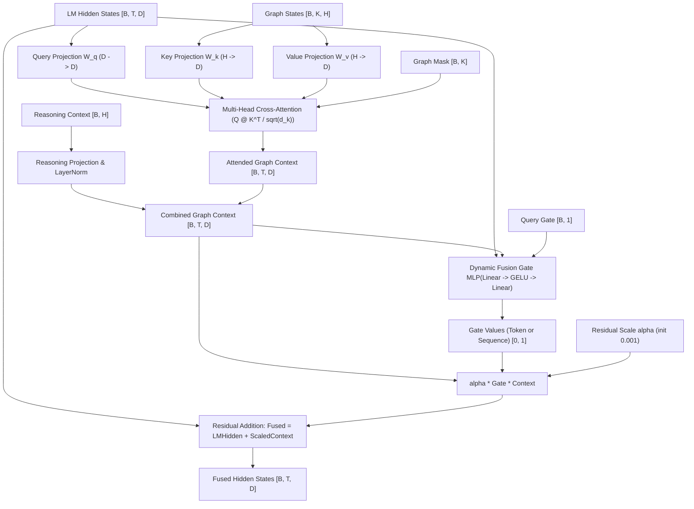

### Multi-Head Cross-Attention Formulation

Cross-attention queries graph slots from token representations:
$$Q = X W_q, \quad K = G W_k, \quad V = G W_v$$
$$\text{Attention}(Q, K, V) = \text{Softmax}\left(\frac{Q K^T}{\sqrt{d_k}} + M_{\text{graph}}\right) V$$
where $M_{\text{graph}}$ masks padded/inactive graph slots with $-\infty$ and prevents NaN propagation when all candidate slots are masked.

### Identity-Preserving Residual Gating

1. **Dynamic Gating:** Balances backbone representation fidelity against graph memory:
   $$\text{Gate} = \sigma\left(\text{MLP}\left([X, C_{\text{graph}}]\right)\right) \odot g_{\text{query}}$$
2. **Near-Zero Residual Initialization:** The residual scale $\alpha$ initializes to near-zero (e.g. $0.001$):
   $$X_{\text{fused}} = X + \alpha \cdot \text{Gate} \odot C_{\text{graph}}$$
   This ensures that untrained graph modules act as an exact identity pass-through initially without degrading language modeling performance, while providing non-zero gradient flow across attention, projection, and gating weights from step zero.
3. **Empty Graph Guarantee:** When the graph is empty or entirely masked, `RUTAMGraphFusion` returns `hidden_states` unmodified with zero gates and no NaNs.

## Milestone 11 — LFM3 Backbone Adapter

Implemented in Phase 1 (Prompt 11/20). Implements `RUTAMLFM3Adapter` and supporting
architecture discovery protocols bridging language model backbones and native graph fusion
without fabricating internal private APIs or downloading heavy pretrained checkpoints during tests.

### Architecture and Layer Integration Flow

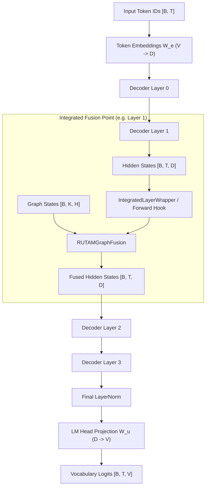

### The BackboneProtocol Contract

To decouple model integration from proprietary packaging, `BackboneProtocol` defines a typed,
`@runtime_checkable` interface:
- Hidden dimension discovery (`get_hidden_dim() -> int`)
- Vocabulary size discovery (`get_vocab_size() -> int`)
- Layer count and sequence enumeration (`get_num_layers() -> int`, `get_layers() -> Sequence[nn.Module]`)
- Token input embedding access (`get_input_embeddings() -> nn.Module`)
- Logit projection extraction (`get_output_logits(hidden_states) -> Tensor`)
- Forward execution (`forward(input_ids, attention_mask=None) -> Any`)

### Synthetic Testing Double

To guarantee deterministic, ultra-fast CPU testing without requiring a 1.7B parameter checkpoint,
`SyntheticBackbone` implements the full `BackboneProtocol`. It models token embedding, multi-layer
residual decoder blocks, final normalization, and logit projection with configurable synthetic
dimensions (`hidden_dim`, `num_layers`, `vocab_size`).

### Parameter Management and Fine-Tuning Strategies

1. **Parameter Freezing:** `adapter.freeze_backbone()` disables gradients across all base model weights, ensuring safe parameter-efficient fine-tuning (PEFT).
2. **Selective Layer Unfreezing:** `adapter.unfreeze_layers([indices])` allows selective training of specific decoder layers while keeping the remainder of the backbone frozen.
3. **Trainable Fusion Isolation:** Fusion module parameters remain cleanly isolated in `fusion_modules`, preventing unintended parameter pollution of the backbone module hierarchy.
4. **Differentiated Learning Rates:** `adapter.get_parameter_groups(backbone_lr, fusion_lr)` returns partitioned optimizer parameter groups tailored for adapter-style training regimes.
5. **Reversible Integration:** Supports both explicit wrapping (`IntegratedLayerWrapper`, reversible via `unwrap_layers()`) and non-intrusive forward hooks (`LayerIntegrationHook`, reversible via `detach_hooks()`).

## Milestone 12 — Complete Native Graph-Aware Forward Pass (RUTAMForCausalLM)

Implemented in Phase 1 (Prompt 12/20). Implements `RUTAMForCausalLM` unifying the backbone
language model, graph query head, graph encoder, selector, traversal, fusion, and write head
into a single cohesive causal language model architecture.

### Unified End-to-End Pipeline Architecture

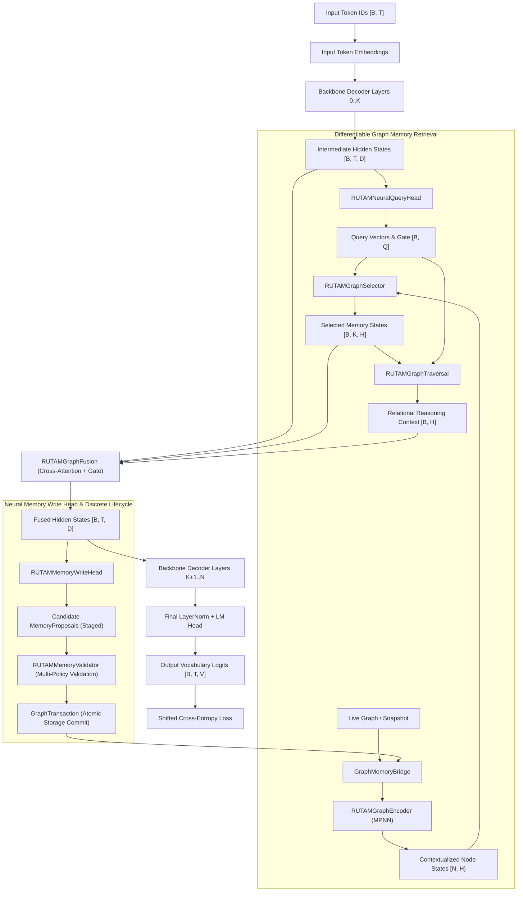

### Unified Forward Pass Components

1. **Integrated Backbone Execution:**
   Supports any model conforming to `BackboneProtocol` (including `SyntheticBackbone` and adapted models). Hidden representations pass through initial decoder layers, branch into graph query and cross-attention fusion, and continue through remaining decoder layers.
2. **Causal Next-Token Loss:**
   When `labels` are provided, computes next-token prediction cross-entropy loss over shifted logits and labels with `ignore_index=-100`.
3. **Graph Memory Bridge (`GraphMemoryBridge`):**
   Coordinates live graph state snapshots, neural node encoding caches, and disk reloads. When the underlying graph undergoes version mutations, cached representations are invalidated automatically.
4. **Parameter Group Management (`ParameterGroupManager`):**
   Partitions unified model parameters into optimizer groups by submodule role (`backbone`, `encoder`, `selector`, `query_head`, `traversal`, `fusion`, `write_head`) and weight decay policy, enabling differential learning rates.
5. **Decoupled Memory Write Lifecycle:**
   Forward computation optionally generates staged `MemoryProposal` records via `propose_memory_updates()`. Validation (`validate_memory_updates()`) and commits (`commit_memory_updates()`) remain explicit APIs executed outside the gradient graph, upholding strict data boundaries and ACID persistence guarantees.

---

## Relation-Aware Neural Graph Attention (`RUTAMGraphAttention`)

Implemented in Milestone 13. Provides relation-aware multi-head graph attention over sparse directed graph structures, supporting intra-graph message passing and query-conditioned graph contextualization.

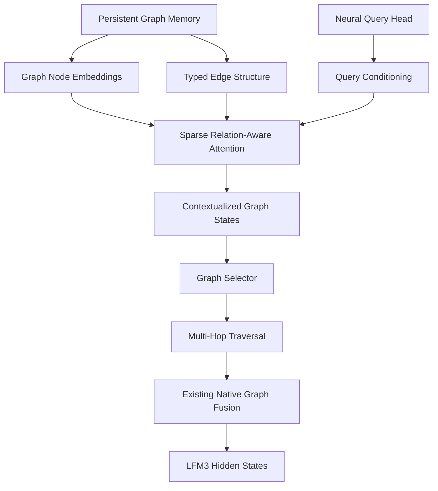

### Key Technical Characteristics

1. **Sparse Multi-Head Edge Attention (`SparseRelationEdgeAttention`):**
   - For directed edge $u \to v$ with relationship $r$, computes:
     $$\text{score}(u, v, r) = \frac{(W_q h_v)^\top (W_k h_u + R_r)}{\sqrt{d_{\text{head}}}} + \text{bias}(r) + \text{bias}(w_e) + \text{bias}(q, r)$$
   - Performs strictly per-destination softmax normalization:
     $$\alpha_{u, v} = \frac{\exp(\text{score}(u, v, r) - \max_{u'} \text{score}(u', v, r))}{\sum_{u'} \exp(\text{score}(u', v, r) - \max_{u'} \text{score}(u', v, r))}$$
   - Uses PyTorch native `scatter_reduce_` and `index_add_` without materializing dense $N \times N$ matrices.
   - For destinations with no incoming edges, provides an explicit zero-message fallback and preserves solitary node identity through residual self-projections.
2. **Query Conditioning (`RelationAttentionBias`):**
   - Learns query-to-relation interaction vectors $W_{qr} q \in [B, R, H_{\text{heads}}]$, allowing incoming neural queries to modulate structural edge attention.
   - Supports unbatched $[Q]$ and batched $[B, Q]$ queries bounded by strict memory budgets.
3. **Integration and Extensibility:**
   - `RUTAMGraphEncoder` supports `encoder_mode` in (`"message_passing"`, `"graph_attention"`, `"hybrid"`).
   - `GraphAttentionBridge` connects `RUTAMGraphAttention`, `RUTAMGraphSelector`, and `RUTAMGraphFusion`.


