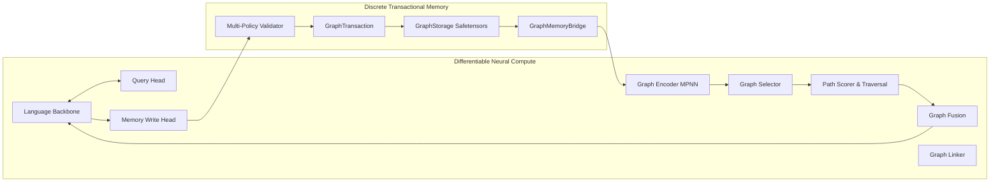

# RUTAM Architecture Integration Audit Specification

## 1. Architectural Scope & Submodule Taxonomy

RUTAM unifies causal language modeling with native, transactional, persistent graph memory. The architecture partitions computation into **differentiable neural retrieval/fusion** (governed by PyTorch autograd) and **discrete transactional memory lifecycle** (governed by ACID-like transactional semantics outside autograd).



---

## 2. Tensor Contract Enforcement

All tensors passing across module boundaries must strictly adhere to the following contracts:

| Tensor / Interface | Expected Shape | Dtype | Device | Layout Requirements |
| :--- | :--- | :--- | :---: | :--- |
| `input_ids` | $[B, T]$ | `torch.long` | CPU | Memory-contiguous; $0 \le \text{token} < V$ |
| `labels` | $[B, T]$ | `torch.long` | CPU | Memory-contiguous; $\ge -100$ |
| `attention_mask` | $[B, T]$ | `torch.bool` / `float32` | CPU | Memory-contiguous |
| `QueryHeadOutput.query_vectors` | $[B, K, D_q]$ | `torch.float32` | CPU | Finite (no NaN/Inf); contiguous |
| `QueryHeadOutput.query_gate` | $[B, 1]$ or $[B]$ | `torch.float32` | CPU | Finite; bounded in $[0.0, 1.0]$ |
| `GraphState.node_ids` | $[N]$ | `torch.long` | CPU | Unique identifiers; contiguous |
| `GraphState.node_embeddings` | $[N, D_e]$ | `torch.float32` | CPU | Finite; unit normalized or bounded |
| `GraphState.edge_index` | $[2, E]$ | `torch.long` | CPU | Contiguous; valid node indices $[0, N-1]$ |
| `GraphState.edge_types` | $[E]$ | `torch.long` | CPU | Contiguous; valid relation indices |
| `GraphState.edge_weights` | $[E]$ | `torch.float32` | CPU | Finite; bounded in $[0.0, 1.0]$ |
| `GraphSelectorOutput.selected_states` | $[B, S, D_h]$ | `torch.float32` | CPU | Finite; top-$k$ selected states |
| `GraphSelectorOutput.selected_scores` | $[B, S]$ | `torch.float32` | CPU | Finite; normalized relevance scores |
| `TraversalOutput.path_representations` | $[B, P, D_p]$ | `torch.float32` | CPU | Finite; relational path states |
| `TraversalOutput.reasoning_context` | $[B, D_h]$ | `torch.float32` | CPU | Finite; aggregated reasoning vector |
| `FusionOutput.fused_hidden_states` | $[B, T, D_h]$ | `torch.float32` | CPU | Finite; modulated representations |
| `FusionOutput.fusion_gate` | $[B, T, 1]$ | `torch.float32` | CPU | Finite; bounded in $[0.0, 1.0]$ |
| `RUTAMCausalLMOutput.logits` | $[B, T, V]$ | `torch.float32` | CPU | Finite; vocabulary predictions |
| `RUTAMCausalLMOutput.loss` | Scalar $[]$ | `torch.float32` | CPU | Finite; non-negative |

---

## 3. Gradient Flow & Backward Pass Verification

The audit verifies backpropagation across 8 neural submodules:
1. **Query Head** (`RUTAMNeuralQueryHead`): Gradients propagate through backbone projection, intermediate MLP, query vector projections, and query decision gate.
2. **Graph Encoder** (`RUTAMGraphEncoder`): Gradients propagate through input node projections, edge type embeddings, and MPNN message-passing layers.
3. **Graph Attention** (`RUTAMGraphAttention`): Gradients propagate through multi-head query/key/value projections, relation key/value embeddings, and attention bias scaling.
4. **Graph Selector** (`RUTAMGraphSelector`): Gradients propagate through query and node relevance projection heads.
5. **Path Scorer** (`RUTAMPathScorer`): Gradients propagate through query-path additive/dot-product projections and path attention distributions.
6. **Graph Fusion** (`RUTAMGraphFusion`): Gradients propagate through cross-attention projections, output projections, and residual fusion gate.
7. **Memory Write Head** (`RUTAMMemoryWriteHead`): Gradients propagate through write decision gate, operation classifier, and candidate memory projections.
8. **Graph Linker** (`RUTAMGraphLinker`): Gradients propagate through structural feature projections, link compatibility scorer, and relation classifier.

### Isolation Rules
- **Frozen Backbone Policy**: During graph memory fine-tuning (`backbone_frozen=True`), language model backbone parameters must receive strictly zero gradients (`grad is None`).
- **Unfrozen Fine-Tuning Policy**: During end-to-end full fine-tuning, all backbone and memory parameters receive active gradients without numeric underflow or overflow.

---

## 4. Complete 14-Step Memory Lifecycle Guarantees

```
Step 1:  Empty Graph Initialization (Version 0, 0 nodes, 0 edges)
Step 2:  Candidate Proposal Generation (CREATE_NODE, candidate embeddings)
Step 3:  Discrete Multi-Policy Validation (Schema, Provenance, Security)
Step 4:  Atomic Transactional Commit (GraphTransaction, Version advances to 1)
Step 5:  Cache Invalidation & Bridge Sync (Invalidates cached tensors, V=1 active)
Step 6:  Retrieval & Read Verification (Forward pass selects memory, fusion active)
Step 7:  Snapshot Persistence (graph.safetensors, graph.json, graph.manifest.json)
Step 8:  Snapshot Cryptographic Integrity (SHA-256 and byte length validation)
Step 9:  Snapshot Round-Trip Reload (Fresh Graph instance matches original topology)
Step 10: Multi-Node & Edge Update (Create linked nodes, advance version to 3)
Step 11: Monotonic Version Advance (0 -> 1 -> 2 -> 3 with audit log lineage)
Step 12: Stale Update Rejection (Proposal from V=0 rejected with ValidationDecision.STALE)
Step 13: Conflict & Constraint Validation (Invalid references rejected with REJECT)
Step 14: Rollback & Recovery Execution (Transaction abort rollback; snapshot rollback to V=1)
```

---

## 5. Checkpoint Verification & Recovery Protocol

- **Compound Checkpoint Structure**: Checkpoints persist weights, graph topology, optimizer states, hyperparameters, and execution metadata atomically.
- **Cryptographic Manifest**: Every saved file is hashed with SHA-256 and recorded with its byte count in `manifest.json`.
- **Integrity Verification**: `verify_checkpoint_integrity()` recalculates SHA-256 digests across all files before loading.
- **Fault Detection & Rollback**: If any file is corrupted or truncated, `load_checkpoint` raises `CorruptSnapshotError`, and `get_latest_checkpoint()` automatically falls back to the preceding valid checkpoint.
