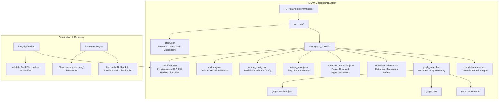

# RUTAM Native Model Checkpoint & Persistence System

The RUTAM checkpoint system provides safe, robust, and reproducible persistence of both neural parameters and persistent graph memory without relying on unsafe Python pickle.

## Architecture Diagram

## Checkpoint Philosophy

1. **Logical Separation of Assets**:
   - Neural parameters are model weights stored in `model.safetensors`.
   - Persistent graph memory is factual knowledge stored in `graph_snapshot/`.
   - Optimizer buffers are training runtime states stored in `optimizer.safetensors`.
2. **Zero-Pickle Security**:
   - All tensors are serialized using the safe, memory-mapped `safetensors` format.
   - All metadata, hyperparameters, and schemas are serialized using standard JSON.
3. **Atomic Operations**:
   - Saves write to an isolated temporary directory (`tmp_*`) before atomic rename.
   - Interrupted processes cannot produce partially valid checkpoints.
4. **Cryptographic Provenance**:
   - Every file within a checkpoint is hashed with SHA-256 and recorded in `manifest.json`.
