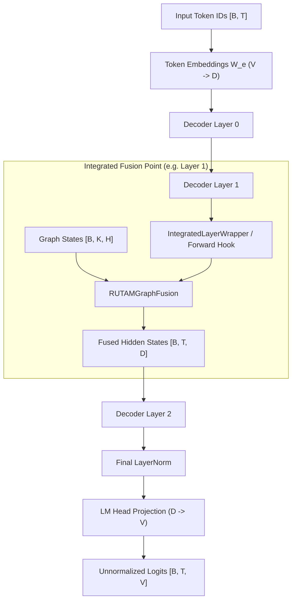

# LFM3 Backbone Adapter Integration Guide

Developed by **Anvaya.sh** for the RUTAM graph-memory foundation.

## Overview

The `RUTAMLFM3Adapter` subsystem bridges language model backbones (such as `LiquidAI/LFM3-1.7B-Base`)
and RUTAM's native graph-memory fusion layers. It enables graph memory integration while strictly
preserving model parameter boundaries, providing parameter-efficient freezing, and guaranteeing
exact identity pass-through when graph memory is empty or inactive.

## Architectural Components



## The BackboneProtocol Contract

To remain independent of proprietary model packaging and prevent brittle hardcoded assumptions,
backbone integration targets the runtime-checkable `BackboneProtocol`:

```python
@runtime_checkable
class BackboneProtocol(Protocol):
    def get_hidden_dim(self) -> int: ...
    def get_vocab_size(self) -> int: ...
    def get_num_layers(self) -> int: ...
    def get_input_embeddings(self) -> nn.Module: ...
    def get_layers(self) -> Sequence[nn.Module]: ...
    def get_output_logits(self, hidden_states: torch.Tensor) -> torch.Tensor: ...
    def forward(self, input_ids: torch.Tensor, **kwargs: Any) -> Any: ...
```

Models that implement this protocol or expose standard Transformer attributes (`layers`, `config`,
`embed_tokens`) are automatically discovered and validated by `inspect_backbone()`.

## SyntheticBackbone Test Double

For deterministic, fast CPU-only unit and regression testing without requiring 1.7B parameter
weight checkpoints or network downloads, RUTAM provides `SyntheticBackbone`. It implements the full
`BackboneProtocol` with configurable `hidden_dim`, `num_layers`, and `vocab_size`.

## Parameter Freezing and Efficiency Policies

1. **Backbone Freezing:** When `backbone_frozen: true`, all backbone weights have `requires_grad = False`.
2. **Trainable Graph Modules:** Graph fusion modules remain trainable (`requires_grad = True`), enabling
   parameter-efficient fine-tuning (PEFT) without modifying base LM representations.
3. **Selective Layer Unfreezing:** `adapter.unfreeze_layers([idx1, idx2])` unfreezes specific decoder
   layers for partial fine-tuning.
4. **Differentiated Learning Rates:** `adapter.get_parameter_groups()` provides distinct optimizer parameter
   groups for backbone weights (e.g., $10^{-5}$) versus graph fusion weights (e.g., $10^{-4}$).

## Integration Modes

- **Explicit Wrapping (`integration_mode: explicit`):** `IntegratedLayerWrapper` wraps designated layers
  directly in `backbone.layers`. It can be cleanly reversed using `adapter.unwrap_layers()`.
- **Forward Hooks (`integration_mode: hook`):** Attaches PyTorch forward hooks via `LayerIntegrationHook`
  to modify layer activations in place without altering model module hierarchy. Cleanly reversible via
  `adapter.detach_hooks()`.

## Configuration Reference

```yaml
lfm3_adapter:
  backbone_id: LiquidAI/LFM3-1.7B-Base
  enabled: true
  fusion_locations: [1, 3]
  backbone_frozen: true
  graph_modules_trainable: true
  integration_mode: explicit
  require_verified_layers: true
  preserve_output_interface: true
  enable_cache: false
  allow_remote_code: false
```
