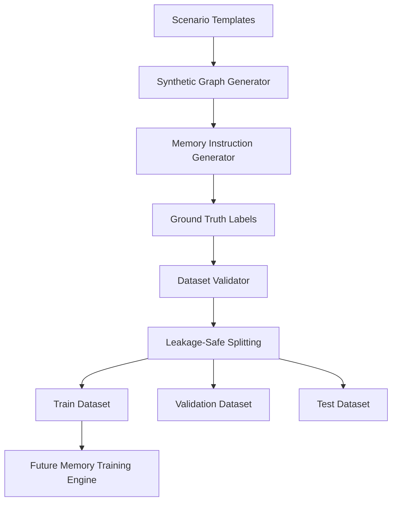

# RUTAM Native Memory Instruction Dataset

Developed by **Anvaya.sh**. Milestone 15 creates the first structured instruction dataset for training RUTAM's native memory architecture.

## Overview

## Dataset Specifications

- **Total Examples:** 1,000 deterministic, synthetic examples.
- **Splits:**
  - `train.jsonl`: 815 examples (81.5%)
  - `validation.jsonl`: 100 examples (10.0%)
  - `test.jsonl`: 85 examples (8.5%)
- **Directory Layout:**
  - `data/memory_training/train.jsonl`
  - `data/memory_training/validation.jsonl`
  - `data/memory_training/test.jsonl`
  - `data/memory_training/schema.json`
  - `data/memory_training/statistics.json`
  - `data/memory_training/manifest.json`

## Category Distribution

| Category | Count | Operations / Behavior |
|---|---:|---|
| New memory creation | 180 | `CREATE_NODE` |
| Existing memory updates | 140 | `UPDATE_NODE` |
| Relationship linking | 140 | `PROPOSE_LINK` |
| Irrelevant info / no-op | 140 | `NO_OP` |
| Duplicate detection | 100 | `NO_OP` (Rejected) |
| Contradictions / disputes | 100 | `REQUEST_VALIDATION` (Deferred) |
| Multi-hop associations | 100 | Transitive graph reasoning |
| Authorization boundaries | 100 | `REQUEST_VALIDATION` (Rejected) |
| **Total** | **1,000** | |

## Integrity and Leakage Prevention

1. **Scenario Family Grouping:** All examples are partitioned by `scenario_family`. Paraphrases, synonyms, and entities from the same scenario family are strictly isolated to either train, validation, or test.
2. **Zero Leakage:** Validated by `DatasetValidator.validate_splits()` ensuring no scenario family or example ID overlaps across splits.
3. **Cryptographic Checksums:** `manifest.json` records SHA-256 hashes of every split file and metadata file.
4. **Synthetic Limitation Notice:** These records are synthetic instructional scenarios for local CPU training and evaluation; they do not represent real-world factual claims.
