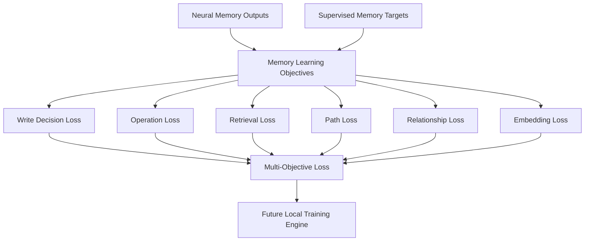

# RUTAM Native Memory Learning Architecture

Developed by **Anvaya.sh**. Milestone 14 implements the joint multi-objective learning framework that teaches RUTAM when, what, where, and how to form and update graph memory.

## Architectural Overview

## Learning Objectives and Mathematical Formulation

1. **Memory Write Decision ($\mathcal{L}_{\text{write}}$):**
   - Binary cross-entropy with logits over unmasked write gate predictions:
     $$\mathcal{L}_{\text{write}} = -\sum \left[ y \log \sigma(l) + (1 - y) \log(1 - \sigma(l)) \right]$$
   - Handles class imbalance through configurable positive weighting (`pos_weight`).
   - Unlabeled examples are explicitly masked to prevent treating unlabeled facts as negative samples.

2. **Memory Operation Classification ($\mathcal{L}_{\text{operation}}$):**
   - Multi-class cross-entropy over 7 discrete memory operations:
     `NO_OP (0)`, `CREATE_NODE (1)`, `UPDATE_NODE (2)`, `PROPOSE_LINK (3)`, `PROPOSE_MERGE (4)`, `SUPERSEDE_NODE (5)`, `REQUEST_VALIDATION (6)`.
   - Supports class-masked loss and stable numeric mapping.

3. **Memory Embedding Alignment ($\mathcal{L}_{\text{embedding}}$):**
   - Cosine alignment and triplet ranking between proposed memory representations $\hat{e}$ and reference memory embeddings $e_{\text{ref}}$:
     $$\mathcal{L}_{\text{align}} = 1 - \frac{\hat{e} \cdot e_{\text{ref}}}{\|\hat{e}\|_2 \|e_{\text{ref}}\|_2}$$
   - Prevents representation collapse while allowing multiple positive graph targets.

4. **Graph Retrieval Learning ($\mathcal{L}_{\text{retrieval}}$):**
   - Cross-entropy over bounded candidate memories or binary cross-entropy for multi-positive recall.
   - Evaluated using Recall@K (K=1, 3, 5) and Mean Reciprocal Rank (MRR).

5. **Query-Gating Decision ($\mathcal{L}_{\text{query}}$):**
   - Binary cross-entropy training whether graph querying is beneficial for a specific context.

6. **Relational Link and Path Supervision ($\mathcal{L}_{\text{link}}, \mathcal{L}_{\text{path}}$):**
   - Integrates linker prediction scores and bounded path scoring from Prompts 05 and 06.

## Loss Balancing Strategies

- **Fixed Balancing (`FixedLossBalancer`):** User-configured linear weights:
  $$\mathcal{L}_{\text{total}} = \sum_i \lambda_i \mathcal{L}_i$$
- **Uncertainty Balancing (`UncertaintyLossBalancer`):** Homoscedastic task uncertainty (Kendall & Gal):
  $$\mathcal{L}_{\text{total}} = \sum_i \left( \frac{1}{2} \exp(-s_i) \mathcal{L}_i + \frac{1}{2} s_i \right)$$
  where $s_i = \log \sigma_i^2$ are learned parameters representing task-specific noise variance.

## Curriculum Learning Stages

- **Stage A — Basic Memory Decisions:** Learn when to write vs no-op.
- **Stage B — Memory Operations:** Learn discrete mutation types (create, update, link, supersede).
- **Stage C — Retrieval:** Learn neural query alignment and candidate selection.
- **Stage D — Relational Linking:** Learn association and edge prediction.
- **Stage E — Integrated Memory Tasks:** Joint end-to-end memory reasoning.
