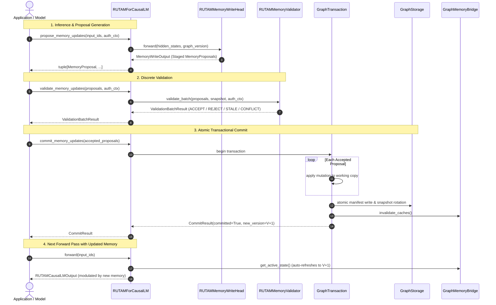

# RUTAM Native Memory Lifecycle & Concurrency Management

## Lifecycle Overview

Memory in RUTAM is never mutated implicitly during gradient calculation or standard forward passes. Writing to memory is partitioned into four distinct phases: **Proposal Generation**, **Discrete Multi-Policy Validation**, **Atomic Transactional Commitment**, and **Neural Cache Invalidation**.

---

## 1. Proposal Generation
- Executed by `RUTAMMemoryWriteHead`.
- Differentiable neural components:
  - **Write Gate**: Evaluates whether current context warrants creating or updating memory.
  - **Operation Predictor**: Classifies proposed action (`CREATE_NODE`, `UPDATE_NODE`, `DELETE_NODE`, `PROPOSE_LINK`, `REMOVE_LINK`, `SUPERSEDE_NODE`, `PROPOSE_MERGE`).
  - **Memory Projection**: Generates candidate dense memory embeddings.
  - **Target Scorer**: Scores candidate embeddings against existing retrieved nodes.
- Each generated `MemoryProposal` captures:
  - `proposal_id`: Unique identifier (UUID).
  - `operation`: Proposed discrete action.
  - `candidate_embedding`: Continuous vector representation.
  - `provenance`: Origin metadata, timestamps, and authorization claims.
  - `source_graph_version`: Graph version at time of proposal generation.

## 2. Discrete Multi-Policy Validation
- Executed by `RUTAMMemoryValidator`.
- Non-differentiable discrete logic outside PyTorch autograd.
- Checks:
  1. **Structural Schema Check**: Tensor types, CPU device, dimension alignment, non-NaN/Inf, valid targets.
  2. **Provenance & Security Verification**: Enforces authorization categories, valid user roles, and rejects fabricated model sources.
  3. **Duplicate Detection**: Identifies identical IDs or high-similarity content vectors to prevent memory bloat.
  4. **Conflict & Contradiction Detection**: Detects mutually exclusive relationship types or version skew.
  5. **Concurrency & Stale Update Rejection**: Verifies `source_graph_version == current_graph_version`. Stale proposals are rejected with `ValidationDecision.STALE`.

## 3. Atomic Transactional Commit
- Executed by `GraphTransaction`.
- Guarantees ACID-like transaction boundaries:
  - **Isolated Working Copy**: Mutations are applied to a sandbox graph copy.
  - **Audit Logging**: Every applied operation is logged with timestamp, user ID, and reason.
  - **Atomic Persistence**: Safetensors and manifest are written to disk using atomic rename operations.
  - **Snapshot Retention**: Preserves recent snapshots (`preserve_snapshots`) for rollback.
  - **Rollback on Error**: If any mutation fails, the transaction rolls back cleanly without leaving corrupted state.

## 4. Cache Synchronization & Invalidation
- `GraphMemoryBridge` maintains active `GraphState` and neural encodings from `RUTAMGraphEncoder`.
- Upon successful commit, `bridge.invalidate_caches()` clears cached tensors.
- Subsequent forward passes automatically recompute or reload state at the updated version.
