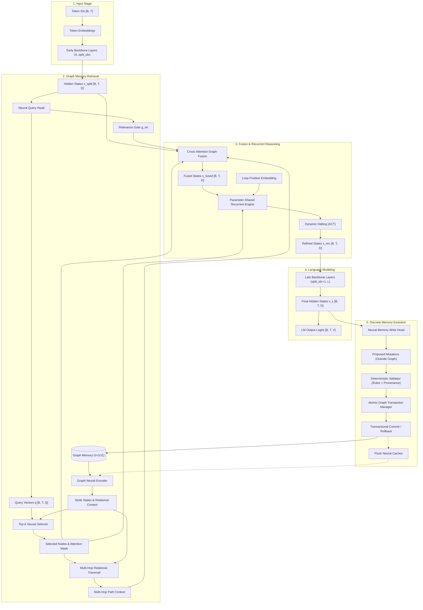

# RUTAM v0.1 Complete Architecture Specification

## 1. System Overview

RUTAM (Relational Unified Thought and Memory) unifies a causal language model backbone with differentiable graph memory and parameter-shared recurrent reasoning.

---

## 2. The Four Architectural Modes

| Mode | Subsystems Active | Mathematical Formulation |
| :--- | :--- | :--- |
| **`baseline`** | Backbone only | $x_L = \text{Backbone}(x_0)$ |
| **`graph_native`** | Backbone + Graph Retrieval + Fusion + Write Head | $x_{\text{fused}} = \text{Fusion}(x_{\text{split}}, \text{GraphRetrieval}(x_{\text{split}}))$ |
| **`recurrent`** | Backbone + Recurrent Engine | $x_{\text{rec}} = \text{RecurrentLoop}^N(x_{\text{split}})$ |
| **`full_rutam`** | Backbone + Graph Retrieval + Fusion + Recurrent + Write Head | $x_{\text{rec}} = \text{RecurrentLoop}^N(\text{Fusion}(x_{\text{split}}, \text{GraphRetrieval}(x_{\text{split}})))$ |

### Mode Isolation and Identity Pass-Through
When `recurrent` is disabled, the recurrent integration layer acts as a zero-overhead identity function:
$$\text{RecurrentIntegration}(x) = x$$
When `graph_native` components are disabled, graph traversal, selection, and fusion are bypassed:
$$\text{FusionIntegration}(x) = x$$

---

## 3. Subsystem Breakdown

### 3.1 Neural Query Head & Selection
Given intermediate hidden state $h_t \in \mathbb{R}^D$:
1. **Relevance Gate:** $g_t = \sigma(W_{\text{gate}} h_t + b_{\text{gate}}) \in [0, 1]$
2. **Query Vector:** $q_t = \text{RMSNorm}(W_{\text{query}} h_t) \in \mathbb{R}^Q$
3. **Node Scoring:** $s_{t, i} = \frac{q_t^\top W_{\text{score}} v_i}{\sqrt{d_k}}$
4. **Stable Top-K Selection:** Selects top $K$ nodes with differentiable masking.

### 3.2 Graph Cross-Attention Fusion
Retrieves node embeddings $V_{\text{sel}} \in \mathbb{R}^{K \times D_{\text{graph}}}$ and multi-hop path context $C_{\text{path}}$:
$$A = \text{Softmax}\left(\frac{(W_Q h_t)(W_K V_{\text{sel}})^\top}{\sqrt{d}}\right)$$
$$\text{Context}_t = A (W_V V_{\text{sel}}) + W_C C_{\text{path}}$$
$$h'_t = h_t + g_t \cdot \gamma_{\text{fusion}} \odot \text{LayerNorm}(\text{Context}_t)$$
where $\gamma_{\text{fusion}}$ is an elementwise learnable or scalar gate.

### 3.3 Recurrent Reasoning with ACT
Parameter-shared transformer block executed across loops $l \in \{1, \dots, N\}$:
$$h^{(l)} = \text{RecurrentBlock}(h^{(l-1)} + e_{\text{loop}}(l), V_{\text{sel}})$$
Adaptive Computation Time (ACT) halting probability:
$$p^{(l)} = \sigma(W_{\text{halt}} h^{(l)} + b_{\text{halt}})$$
Computation dynamically terminates when $\sum_{l=1}^N p^{(l)} \ge 1 - \epsilon$.

### 3.4 Neural Write Head & Discrete Validation
1. **Mutation Proposal:** Emits candidate operations $\text{Op} \in \{\text{CREATE\_NODE}, \text{UPDATE\_NODE}, \text{PROPOSE\_LINK}, \text{SUPERSEDE}\}$.
2. **Provenance Verification:** Checks source ID, timestamp, and signature against `AuthorizationContext`.
3. **Invariant Check:** Verifies graph acyclicity, degree constraints, and duplicate avoidance.
4. **Transactional Commit:** Validated proposals update disk snapshots atomically, automatically invalidating neural caches.
