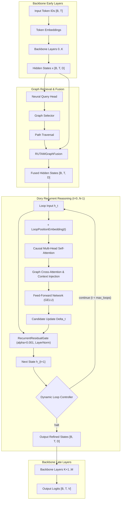

# Dory-Inspired Recurrent Reasoning Architecture for RUTAM

Developed by **Anvaya.sh** for the RUTAM graph-memory foundation.

---

## 1. Overview & Motivation

Standard causal language models operate through a fixed feed-forward stack of $L$ transformer layers:
each token position performs a fixed amount of computation regardless of problem complexity. When coupled
with external graph memory, single-pass cross-attention often lacks the iterative depth needed to
synthesize multi-hop graph reasoning paths, resolve relational contradictions, and perform iterative
deductive inference.

Inspired by **Dory** and recurrent depth architectures (such as Universal Transformers and Adaptive Computation Time),
RUTAM Prompt 19 introduces a **Parameter-Shared Recurrent Reasoning Subsystem**. Rather than allocating
new transformer layer weights for deeper reasoning, a single recurrent reasoning block is reused across
$t = 0 \dots N-1$ iterations.

---

## 2. Core Architectural Pillars

### 2.1 Parameter-Shared Computation
The entire recurrent reasoning subsystem consists of a single `RUTAMRecurrentBlock`. The parameter count
remains strictly constant whether running $t=1$, $t=3$, or $t=8$ recurrent loops:
$$\Theta_{\text{recurrent}}(N) = \Theta_{\text{recurrent}}(1) = \text{const}$$

This provides deep algorithmic reasoning capacity without expanding the parameter footprint of the model.

### 2.2 Learned Loop Position Embeddings
Because block weights are shared across time steps, the network requires an explicit inductive bias to
distinguish early syntactic pondering ($t=0$) from deep relational reasoning ($t=3$ or $t=7$).
`LoopPositionEmbedding` maps iteration index $t \in [0, \text{max\_loops})$ to a learned vector:
$$h_{\text{attn}} = h_t + E_t, \quad E_t = \text{Embedding}(t)$$

### 2.3 Causal Safety Contract
To preserve autoregressive generation semantics, the recurrent block enforces strict causal masking:
$$A_{ij} = -\infty \quad \forall j > i$$
No future token representations at position $j > i$ can ever leak into earlier token positions $i$.
This is verified both via perturbation invariance and exact gradient isolation ($\frac{\partial h_i}{\partial x_j} = 0$).

### 2.4 Graph-Conditioned Recurrence
Unlike generic recurrent transformers, RUTAM recurrent blocks directly condition on retrieved graph memory
at each recurrence step:
1. **Node Cross-Attention**: Attends over selected graph node states $S_g \in \mathbb{R}^{B \times K \times H}$
   using causal query projections and graph key/value projections.
2. **Multi-Hop Path Reasoning Injection**: Projects traversal summary context $C_{\text{reasoning}} \in \mathbb{R}^{B \times H}$
   into hidden space via a learned linear projection and LayerNorm.
3. **Learned Gating & Scaling**:
   $$h_{\text{graph}} = h + \alpha_g \cdot \sigma(W_g [h, C_{\text{graph}}]) \odot C_{\text{graph}}$$
   where $\alpha_g$ is initialized near zero ($0.001$).

### 2.5 Numerical Stability & Identity Preservation
Deep unrolled recurrence without gating easily suffers from gradient explosion or catastrophic activation drift.
RUTAM solves this via three complementary stability mechanisms:
1. **Pre-LayerNorm Architecture**: Normalized inputs before self-attention, cross-attention, and FFN.
2. **Small-Scale Residual Scaling**: $\alpha = 0.001$ (`residual_scale_init`), ensuring that at step 0 the
   block update preserves the input representation identity:
   $$h_{t+1} = \text{LayerNorm}(h_t + \alpha \cdot g_t \odot \Delta h_t) \approx h_t$$
3. **Bounded Gate Activations**: Elementwise or scalar sigmoid gates $g_t \in (0, 1)$ modulate candidate updates.

### 2.6 Dynamic Loop Controller (Adaptive Halting)
`DynamicLoopController` evaluates intermediate hidden representations after each loop using sequence pooling
and an MLP:
$$p_{\text{continue}} = \sigma(\text{MLP}(\text{Pool}(h_t)))$$
Budget invariants are strictly enforced:
- **Minimum Budget**: Loops $t < \text{min\_loops}$ never halt ($p_{\text{continue}} \to \text{True}$).
- **Maximum Budget**: Loops $t \ge \text{max\_loops}$ always halt ($p_{\text{continue}} \to \text{False}$).
- **Intermediate Halting**: Continues if $p_{\text{continue}} \ge \text{halting\_threshold}$.

---

## 3. Configuration Reference

All settings are encapsulated within `RecurrentConfig` and exposed via `RUTAMConfig.recurrent`:

| Field | Type | Default | Description |
|---|---|---|---|
| `enabled` | `bool` | `False` | Master switch (disabled by default for baseline safety) |
| `hidden_dim` | `int` | `128` | Model hidden representation dimension |
| `num_heads` | `int` | `4` | Number of causal attention heads (`hidden_dim % num_heads == 0`) |
| `intermediate_dim` | `int` | `512` | FFN expansion dimension |
| `max_loops` | `int` | `8` | Upper budget bound on recurrent iterations |
| `min_loops` | `int` | `1` | Lower budget bound on recurrent iterations |
| `default_loops` | `int` | `3` | Static loop count when dynamic halting is inactive |
| `dynamic_halting` | `bool` | `False` | Enables `DynamicLoopController` |
| `halting_threshold` | `float` | `0.5` | Continue probability threshold for dynamic termination |
| `residual_scale_init` | `float` | `0.001` | Small-scale initialization for residual gate stability |
| `use_graph_conditioning` | `bool` | `True` | Injects graph nodes and path traversal context |
| `graph_dim` | `int` | `128` | Dimension of graph memory representations |
| `loop_embedding_dim` | `int` | `128` | Learned loop position embedding dimension |
| `gate_type` | `str` | `"elementwise"` | Gating mode (`"elementwise"` or `"scalar"`) |
| `causal` | `bool` | `True` | Enforces upper-triangular causal attention masking |
| `controller_hidden_dim` | `int` | `64` | Dynamic loop controller MLP hidden dimension |
