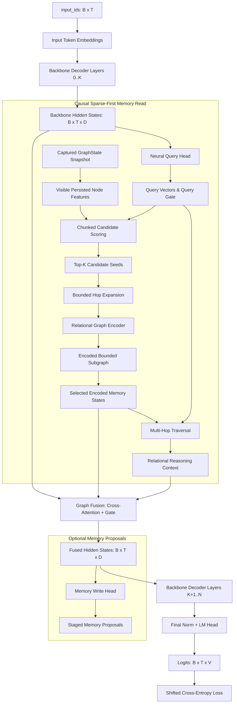

# RUTAM Unified Graph-Aware Forward Pass (`RUTAMForCausalLM`)

## Architectural Overview

`RUTAMForCausalLM` unifies the language model backbone with native graph memory into a single, cohesive, differentiable causal language model. It bridges sequence modeling with explicit structured knowledge without altering the standard causal language modeling interface `(input_ids, labels, attention_mask) -> (logits, loss)`.

---

## Detailed Step-by-Step Forward Execution Pipeline

1. **State Discovery & Active Snapshot Retrieval:**
   Capture one `GraphState` snapshot and build request visibility masks. Dense compatibility mode may use `GraphMemoryBridge` encoding cache; sparse-first mode keeps that same snapshot for candidate selection, neighborhood extraction, and local encoding.

2. **Token Embedding:**
   `input_ids` `[B, T]` are mapped to initial continuous representations via `backbone.get_input_embeddings()`.

3. **Initial Backbone Layer Execution:**
   Token representations flow through initial transformer decoder layers up to the configured fusion and query integration point (`query_layer_idx`, `fusion_layer_idx`).

4. **Neural Memory Querying & Selection:**
   - If visible graph nodes and memory querying are enabled, `RUTAMNeuralQueryHead` pools only the current causal prefix and produces the query and gate.
   - In the default hard-selector path, `RUTAMGraphSelector` scores chunks of persisted node embeddings before relational encoding. Top-k indices are discrete; selected-score recomputation remains differentiable.
   - The forward pass expands selected seeds by `rutam_model.sparse_max_hops` (2 by default), caps the induced subgraph at `rutam_model.max_sparse_nodes` (64 by default), and then calls `RUTAMGraphEncoder` on that subgraph only. General graph traversal keeps its separate three-hop default.
   - Soft selection, full graph attention, or `sparse_selection_enabled: false` uses the dense compatibility path.

5. **Multi-Hop Path Traversal & Reasoning Context:**
   If graph edges are present and `graph_traversal_enabled` is active:
   `RUTAMGraphTraversal` traverses candidate relational paths originating from seed nodes, generating contextualized path representations and synthesizing aggregate `reasoning_context`.

6. **Cross-Attention Graph Fusion:**
   `RUTAMGraphFusion` injects the selected memory representations and relational reasoning context into the sequence hidden states via multi-head cross-attention and a residual fusion gate:
   $$\mathbf{h}_{\text{fused}} = \mathbf{h} + \alpha \cdot \mathbf{g}_{\text{fusion}} \odot \text{Proj}(\text{Context})$$
   When the graph is empty or masked out, the identity function is strictly preserved ($\mathbf{h}_{\text{fused}} = \mathbf{h}$).

7. **Remaining Backbone Decoder Layers:**
   The fused representations pass through the remaining transformer decoder layers.

8. **Logit Projection & Causal Loss:**
   `backbone.get_output_logits` applies final normalization and linear projection to vocabulary logits `[B, T, V]`.
   If `labels` are supplied, next-token cross-entropy loss is calculated with shifted alignment:
   $$\mathcal{L}_{\text{LM}} = \text{CrossEntropy}(\text{logits}_{:, :-1, :}, \text{labels}_{:, 1:})$$

9. **Optional Memory Proposal Generation:**
   When `generate_proposals=True`, `RUTAMMemoryWriteHead` evaluates final representations to generate candidate structured memory operations (`CREATE_NODE`, `UPDATE_NODE`, `PROPOSE_LINK`, etc.) without mutating persistent graph storage.

---

## Forward Diagnostics & Profiling

When `rutam_model.return_memory_diagnostics: true` is configured, `output.diagnostics` provides transparent observability into execution telemetry:
- `has_nodes`: Whether graph snapshot contained active memory nodes.
- `graph_version`: Integer monotonic version of the graph snapshot used for inference.
- `selection_active`: Whether neural query selection retrieved graph states.
- `traversal_active`: Whether multi-hop relational path traversal succeeded.
- `fusion_active`: Whether cross-attention modulated token representations.
- `num_nodes`, `num_edges`: Dimensionality of active graph topology.
