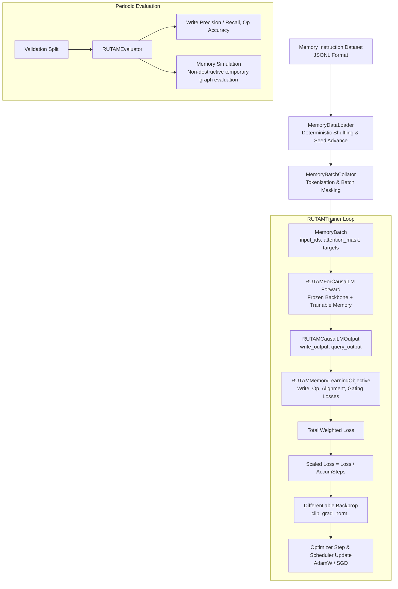

# RUTAM Local Neural Training Engine (`RUTAMTrainer`)

The RUTAM Local Neural Training Engine provides lightweight, modular, CPU-compatible supervised training of RUTAM's native graph-memory modules.

## Architecture Overview

## Key Modules

1. **`RUTAMTrainer` (`src/rutam/training/trainer.py`)**
   - Coordinates the training loop across steps and epochs.
   - Handles gradient accumulation across arbitrary step budgets.
   - Enforces gradient norm clipping (`max_grad_norm=1.0`).
   - Runs periodic validation and early stopping.
   - Produces a typed `TrainingSummary`.

2. **`MemoryBatchCollator` (`src/rutam/training/batch_collator.py`)**
   - Maps raw instruction and context strings into aligned CPU long tensors and boolean attention masks.
   - Extracts `MemoryTrainingTarget` annotations directly from synthetic examples.
   - Preserves before/after graph fixtures for structural supervision.

3. **`MemoryDataLoader` (`src/rutam/training/dataloader.py`)**
   - Reads directly from disk `.jsonl` or in-memory sequences.
   - Advances random generator seed per epoch to guarantee deterministic shuffling.

4. **`TrainingConfig` (`src/rutam/training/train_config.py`)**
   - Configures learning rate, weight decay, optimizer type (`adamw` / `sgd`), schedule (`constant`, `linear`, `cosine`), accumulation steps, and hardware parameters.

5. **`RUTAMEvaluator` (`src/rutam/training/evaluator.py`)**
   - Evaluates held-out validation or test records under `torch.no_grad()`.
   - Optional non-destructive memory simulation mode to evaluate proposal acceptance rates.
